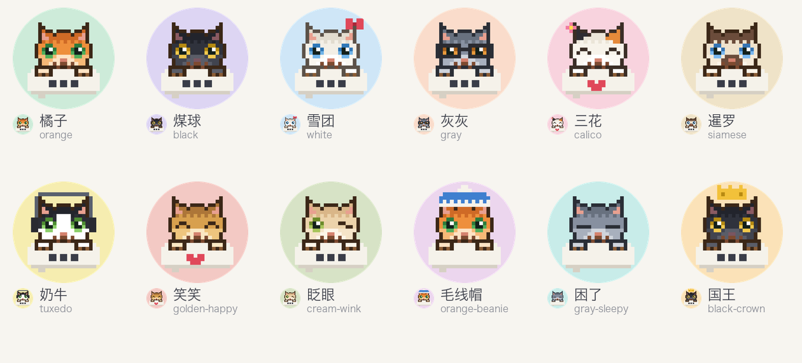

# 成员的预设头像

从 Pupu 图标的像素小猫（`design/icon/pixels.py` 的 `MAIN`）衍生出来：同一只猫、同一个气泡、同一种像素风，换毛色、表情和配件，底色用浅色，和 Pupu 自己的墨色底分开。



## 加一个

在 `presets.py` 的 `PRESETS` 里加一行，写上 id、名字，再选毛色、表情、配件、气泡和底色。要新的毛色、配件就往 `FURS`、`ACCESSORIES` 里加，补丁坐标是猫的 24×24 网格，y 可以是负的（画到头顶上方）。改完跑：

```bash
python3 design/avatars/export.py
```

要 Pillow。出这三样：

| 文件 | 说明 |
|---|---|
| `apps/cloud/public/avatars/<id>.png` | 256×256 方图，带底色，各端自己裁成圆 |
| `apps/cloud/src/avatar-presets.ts` | id 清单，云端只认清单里的 id，iOS 从 `/api/state` 的 `avatarPresets` 拿 |
| `design/avatars/out/overview.png` | 总览，每个下面还有一个 32px 圆形的样子，看耳朵和配件有没有被圆切掉 |

id 发出去以后别改：成员存的是 id，改了他的头像就回到名字的第一个字。

## 头像怎么存

见 `apps/cloud/src/avatars.ts`：预设是静态文件；上传的由客户端裁成方形缩到 256（网页 WebP，iOS JPEG），云端只验文件头、方不方、边长和大小，存进这个 Pupu 的 SQLite。

Pupu 自己的头像也用这一套，只有创建者能换（设置里的「Pupu 的头像」）。没换过用自带的 `/pupu-avatar.png`，所以各端没换过时和以前一样。

## 参考了谁

- 头像地址带上换的时间，换了地址就变、可以长缓存：[immich](https://github.com/immich-app/immich) 的 `getProfileImageUrl`（`profileChangedAt`）。
- 裁剪框的最小缩放是铺满、位置夹在框里：[react-easy-crop](https://github.com/ValentinH/react-easy-crop) 的 `restrictPosition`。只要正方形这一种，没引依赖，自己写在 `apps/cloud/src/client/Avatar.tsx`。
