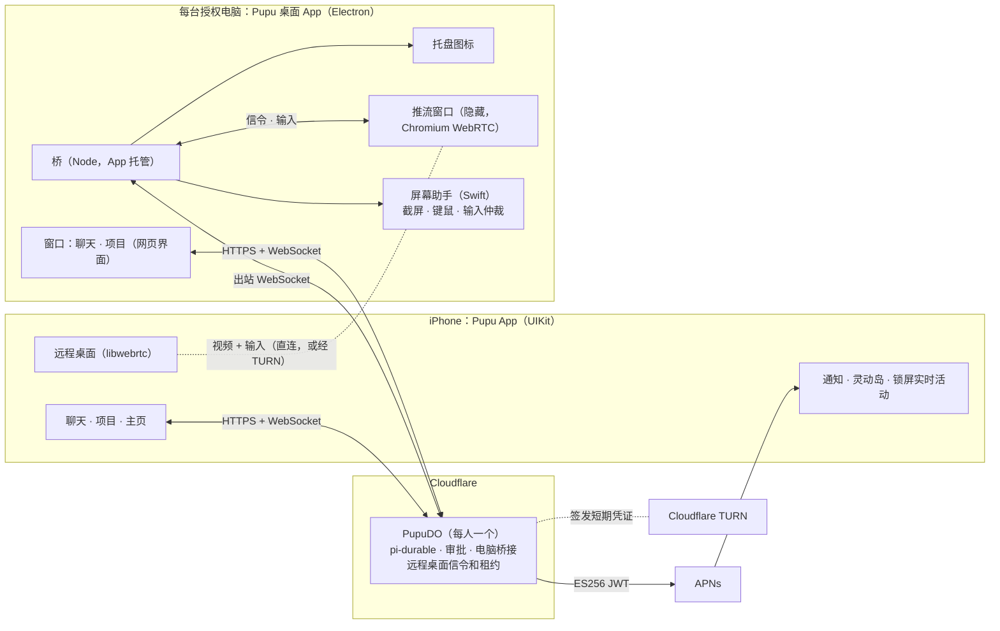

# Pupu 技术方案 v0.3

> 状态：草稿，2026-11-01，等确认。
> - v0.3：M0 推流页放进单独的 Chrome 配置文件里跑（6.9）；ICE 只用 Cloudflare 的 STUN 和 TURN（6.1）；电脑 App 只加载 Pupu 自己的页面，桥不调用本机其他 AI 助手（5.4）；风险里加上截屏会拍到其他 App 的窗口（第 8 节）。
> - v0.2（2026-10-31）：电脑上也要有能用的界面，所以电脑端改成 Electron 桌面 App，和 Grok Bot 一样（2026-10-31 定）。远程桌面的电脑端随之改用 Electron 自带的 Chromium WebRTC。
> - 需求见 `docs/需求说明.md`（v0.2）。本文只回答"怎么做"：各层用什么技术、怎么连起来，远程桌面怎么做，电脑端怎么打包。
>
> 标记：
> - **已定**：已经确认，或已经落地；
> - **建议**：本文提出，等你拍板；
> - **待验证**：要实测。

## 1. 结论

1. **云端不换（已定）。** 还是 Workers + PupuDO + pi-durable。iOS App 和电脑 App 都直接用现有的 HTTP 接口和 WebSocket。要补的是推送、实时活动、锁屏收回的接口，以及远程桌面的信令和 TURN 凭证。
2. **手机端用 UIKit 原生（已定）。** 看远程桌面用原生 libwebrtc，和 Cindy 的 iOS 端一样。
3. **电脑端做成 Electron 桌面 App（已定，2026-10-31）。** 和 Grok Bot 一样：
   - 窗口里直接用网页那套 React 界面；
   - 桥还是现在这份 Node 代码，跑在 Electron 自带的 Node 里，由 App 托管；
   - 菜单栏图标改用 Electron 的托盘；
   - 截屏、键鼠这些 Electron 做不了的，照旧用 Swift 助手。
4. **远程桌面的电脑端用 Chromium WebRTC 推流（建议）。** 和 Cindy 一样，放在一个隐藏窗口里，用 Electron 自带的 WebRTC。手机端用 libwebrtc 接收，两边按标准协议互通。信令走 PupuDO；视频和输入点对点直连，连不通走 Cloudflare TURN。原生 libwebrtc 推流那套验证停掉。
5. **先验证 Chromium 推流（建议）。** 推流页先在这台 Mac 的 Chrome 里跑，和 Electron 是同一套 Chromium WebRTC，不用下载别的包。达标了再按第 7 节开工。

### 需要你拍板的

1. 远程桌面的电脑端用 Chromium WebRTC 推流，停掉原生 libwebrtc 推流的验证；stasel/WebRTC 只用在 iOS 端（6.1）。
2. 审批只认手机：高风险命令和屏幕授权，电脑上的界面只显示、不给批（5.4）。
3. 电脑 App 先只发 Apple 芯片版本（5.5）。
4. 远程桌面默认只看；要操作，得先有这台电脑的屏幕授权；手机上打开远程桌面前先过一次 Face ID（6.7）。
5. 落地顺序：M0 → M1、M2 并行 → M3 → M4 → M5（第 7 节）。

## 2. 总体架构



- **聊天和状态**：手机 App 和电脑 App 的窗口都直连 PupuDO，走现有的 `/agents/pupu/me` WebSocket 和 `/api/*`。
- **电脑执行**：桥主动连 PupuDO，现有。
- **推送**：PupuDO 直接请求 APNs。
- **远程桌面**：
  - 信令走手机 ↔ PupuDO ↔ 桥 ↔ 推流窗口；
  - 视频和输入在手机和推流窗口之间直连，不经过 DO（需求说明 4.5）；
  - 输入到了电脑上，再经桥交给屏幕助手注入。

## 3. 各层技术栈

| 层 | 现在 | 之后 | 变化 |
|---|---|---|---|
| 云端 | Workers + PupuDO + pi-durable + Workers AI | 同左 | 加推送、实时活动、远程桌面信令和 TURN 凭证 |
| 网页 | React + HeroUI v3 | 同左 | 同时是电脑 App 的界面，要补宽屏布局 |
| iOS | UIKit 第一版 | UIKit，iOS 26+ | 加推送、实时活动和远程桌面（libwebrtc） |
| 电脑：外壳 | 无 | Electron（现在的稳定版是 45），electron-builder 打包 | 新增 |
| 电脑：界面 | Swift 菜单栏助手 | Electron 窗口加托盘图标 | 窗口加载网页；托盘替代 Swift 菜单栏 |
| 电脑：桥 | Node，npm 安装，launchd 常驻 | 同一份代码，跑在 Electron 自带的 Node 里，App 托管 | 不用另装 Node |
| 电脑：屏幕 | `pupu-computer-use`（Swift），每次动作单独调用 | 屏幕助手（Swift，常驻）：截屏、键鼠、输入仲裁 | Pupu 的动作和远程桌面的输入都从这里注入 |
| 远程桌面 | 验证中 | 电脑端 Chromium WebRTC；iOS 端 libwebrtc（stasel/WebRTC M156） | 电脑端从原生 libwebrtc 改成 Chromium |

## 4. 云端

### 4.1 接口

- **现有接口不改。** iOS App 的网络层（`apps/ios/Pupu/Net/`）已经直接用 `/agents/pupu/me`（先给快照，再按批发事件）和 `/api/*`。电脑 App 的窗口就是网页，本来就用这些接口。
- **鉴权（已定，现有）**：每台设备一个凭据。`POST /api/pair` 用配对码（或者救急用的访问口令）换凭据，种类有 `phone`、`browser`、`computer`，可以单独吊销（`src/devices.ts`）。要加的（建议）：
  - 电脑 App 的窗口算一种新设备 `desktop`，并记下它装在哪台电脑上；
  - 设备种类现在是客户端自己报的。要让 5.4 的"审批只认手机"站得住，新手机配对时要在已有的手机上确认（M1 做）。
- **新接口（建议）**：
  - `POST /api/push-tokens`：登记推送 token，包括 APNs 设备 token 和实时活动的 push-to-start token，带上环境（sandbox 或 production），挂在当前设备下；
  - `POST /api/live-activities`：登记某个实时活动的更新 token；
  - `POST /api/computers/:id/takeback`：锁屏上的"收回"。和托盘的收回走同一段逻辑（`ComputerGate.takeback`）；
  - 远程桌面的信令接口，见 6.2。

### 4.2 推送（APNs）

- **怎么发（已定，需求说明第 5 节）**：PupuDO 直接 fetch `api.push.apple.com`，用 token 认证。具体做法：
  - 用 .p8 私钥通过 WebCrypto 签 ES256 JWT；
  - JWT 缓存 50 分钟，APNs 要求在 20 到 60 分钟之间刷新；
  - 私钥放 Worker secret。
- **token 表**：放 PupuDO 的 SQLite，`pupu_push_tokens(device_id, token, type, env, created_at, last_seen)`。
  - 设备吊销时一起删；APNs 回 410 或 `BadDeviceToken` 时也删；
  - `pupu_devices` 已经是设备凭据表，不混用。
- **推什么（建议）**：

| 事件 | 推送 | 说明 |
|---|---|---|
| 新的审批 | 通知，类别 `APPROVAL`，带「允许」「拒绝」两个按钮 | 「允许」要先解锁手机（`authenticationRequired`）；`apns-collapse-id` 用审批 id |
| 审批已处理或作废 | 用同一个 `apns-collapse-id` 推一条安静的「已处理」，替换原来那条；同时更新实时活动 | 免得锁屏上留着点了也没用的按钮 |
| Pupu 主动汇报、项目出结果 | 通知 | 按需求说明 4.1 不刷屏：同一项目的连续消息合并成一条 |
| 电脑状态变了 | 实时活动 | 见 4.3 |

- **测试**：本地 `wrangler dev` 发不了 APNs，要用部署后的环境测（需求说明已写）。

### 4.3 实时活动和灵动岛

- **显示什么**：和电脑 App 的托盘图标对齐（需求说明 4.1、4.5）：
  - 哪台电脑；
  - 状态：空闲、在跑命令、操作屏幕、等批准；
  - 正在做什么；
  - 有几条在等批准。
- **状态从哪来（建议）**：桥已经在给菜单栏图标算这份状态，加一个上行帧 `presence` 报给 PupuDO。PupuDO 合并多台电脑的状态，再去更新实时活动。
- **开始和结束**：
  - Pupu 开始在某台电脑上干活时，PupuDO 用 push-to-start token 远程开启实时活动；
  - 空闲一段时间后推 `event: end` 结束。
- **更新**：
  - 请求头：`apns-push-type: liveactivity`，topic 是 `<bundle id>.push-type.liveactivity`；
  - 状态没变就不推，同一个活动每秒最多推一次；
  - 不急的更新用低优先级，系统对实时活动的推送有频率预算。
- **锁屏上的按钮**：批准和收回用 App Intents（`LiveActivityIntent`）做，在 App 进程里调 4.1 的接口。

## 5. 电脑端：Electron 桌面 App

### 5.1 同类产品怎么做

| 产品 | Agent 跑在哪 | 电脑端 | 手机端 | 远程桌面 |
|---|---|---|---|---|
| Cindy | 电脑上（Claude Code、Codex、Pi） | Electron 42（Forge）。正式包关掉 RunAsNode，Node 的活放进 `utilityProcess`。另带至少 6 个 Swift 助手：菜单栏、灵动岛、权限引导、远程桌面输入、截图、手柄；更新器用 Rust（Tauri）写 | Expo / React Native。看远程桌面是原生 Swift 模块，接 libwebrtc（`WebRTC-SDK` 150），用 `AVSampleBufferDisplayLayer` 渲染，支持画中画 | 隐藏窗口里用 Chromium WebRTC 推流；JPEG 兜底由原生 ScreenCaptureKit 助手出图 |
| Alma | 电脑上 | Electron，闭源 | 官方 iOS 客户端，技术栈没公开 | 先在加密中继上发 JPEG 帧，再升级成 WebRTC 视频；手机上可以直接点，也可以当触控板用 |
| Paseo | 电脑上 | Electron（electron-builder、electron-updater）。守护进程用 Electron 自带的 Node 跑（`ELECTRON_RUN_AS_NODE`） | Expo / React Native | 没有 |
| Grok Bot | 云端 | Electron，本机装好占 342 MB。执行进程是独立的 Node 进程，同样用 `ELECTRON_RUN_AS_NODE`，桌面 App 负责托管它 | 入口是桌面 App | 没查到 |

几家的电脑端清一色是 Electron。它们的主界面都在电脑上，Electron 让一套 React 界面同时跑 Mac 和 Windows，还自带 Node 和 WebRTC。Pupu 电脑上也要有能用的界面，所以跟它们一样。

### 5.2 好处和代价

好处：
1. **界面现成。** 窗口直接用网页的 React 界面，不用再写一套。
2. **Node 现成。** 桥原样跑在 Electron 自带的 Node 里，不用在 App 里另带一个约 100 MB 的 Node 二进制。
3. **托盘、开机启动、自动更新、签名公证都有成熟做法**，四家先例都走过。
4. **推流用 Electron 自带的 WebRTC。** Cindy 已经这么做了，不用另带 WebRTC 包。
5. **以后做 Windows**，外壳、托盘、界面、推流都能直接用；键鼠仍要原生代码。

代价：
1. **体积大。** 本机装好的 Grok Bot 占 342 MB；本机抽查的 9 个 Electron 应用在 342 到 735 MB 之间。
2. **常驻内存比原生高。** 窗口关掉时把它销毁，平时只留托盘和桥。
3. **要跟着 Electron 升级。** Electron 大约 8 周出一个大版本，每次都带新的 Chromium。
4. **键鼠、辅助功能、截屏照样要 Swift 助手**，Cindy 也是。
5. **安全面更大。** App 拿到屏幕录制和辅助功能授权以后，别的程序可能借它的身份跑代码。要像 Cindy 那样关掉用不上的入口（5.5）。

已有代码的去向：
- 桥：原样保留，打包时用 esbuild 打成单个文件。
- `pupu-computer-use`：保留，改成常驻的屏幕助手（6.6）。
- Swift 菜单栏（`bridge/menubar.swift`）：电脑 App 出来以后由托盘替代；在那之前开发时照旧用。
- 原生推流的验证代码（`bridge/desktop/`，没提交）：WebRTC 那部分停掉；信令服务和手机观看页留给 M0 用；键鼠注入那段并进屏幕助手。

### 5.3 App 的结构

```
Pupu.app/Contents/
  MacOS/Pupu                     Electron 主进程：托盘、窗口、托管桥、推流窗口、自动更新
  Frameworks/                    Electron 自带的框架和几个 Pupu Helper
  Resources/app.asar             主进程和 preload 的代码；桥用 esbuild 打成单个文件放在这里
  Resources/helpers/pupu-screen  屏幕助手（Swift）：截屏、键鼠、输入仲裁
```

**进程关系（建议）**：
- **主进程**：登录时自动启动，常驻托盘；关掉窗口不退出。从托盘菜单退出 Pupu，这台电脑就下线。
- **桥**：主进程用 `utilityProcess` 拉起，挂了就重启，也就是 Grok Bot 的"App 托管执行进程"。桥再拉起屏幕助手，和现在一样。
  - 不用 Paseo、Grok Bot 那样的 `ELECTRON_RUN_AS_NODE`。它要求打开 RunAsNode，这样别的程序也能借 Pupu 的身份跑任意代码。Cindy 的正式包就关了它，改用 `utilityProcess`。
- **窗口**：加载网页界面，见 5.4。
- **推流窗口**：只在远程桌面会话期间存在，不显示，关掉后台节流（`backgroundThrottling: false`），同 Cindy。
- **授权**：桥和屏幕助手都是 Pupu 拉起的子进程，屏幕录制和辅助功能应该都记在 Pupu 名下（待验证，M4）。

**升级**：用 electron-updater。
- 新版本下载好以后，桥先停止接新请求，等前台命令跑完（设个上限）再重启 App。参考 Grok Bot 的"有活在跑就不杀"。
- 后台命令用 `detached` 起、输出写成文件，不跟着桥一起退出。M4 时实测确认。

### 5.4 电脑上的界面

- **窗口加载线上网页（建议）。** 网页一发布，电脑端就跟着更新，改界面不用发新版 App。
  - 没网时显示本地的"没连上"页面；
  - 只允许在 Pupu 自己的域名里跳转，外链交给系统浏览器；
  - 电脑 App 的窗口和推流窗口只加载 Pupu 自己的页面，不内嵌第三方 AI 服务的网页。桥执行命令时，也不调用本机已经装好的其他 AI 助手的命令行工具和账号。理由：Pupu 的模型能力统一走云端，避免借用本机其他工具的账号和权限；
  - 窗口开 sandbox 和 contextIsolation，网页拿不到 Node；
  - preload 只给几个窄接口：本机开关、这台电脑的状态、打开系统设置里的授权页。
- **配对**：第一次打开时配对，沿用现有的配对码。
  - 窗口拿一份 `desktop` 设备凭据，桥拿一份电脑凭据；
  - 凭据用 Electron 的 safeStorage 加密存放，密钥在钥匙串里。
- **布局**：网页现在是按手机做的。电脑窗口要补宽屏布局，比如项目列表常驻左边。电脑端的样式另外定。
- **审批只认手机（建议）。** Pupu 能操作电脑的屏幕和命令行，电脑上的任何界面都可能被它自己点"允许"。所以：
  - 高风险命令和屏幕授权只认手机 App 的批准；
  - 电脑 App 里的审批卡片照常显示，按钮换成"去手机上批准"；
  - 云端也不收 `desktop` 和 `browser` 设备发来的批准。电脑浏览器里的网页有同样的问题，一起这么处理；
  - 这条等 M1 的推送审批做好再生效，在那之前网页照旧能批；
  - 以后要在电脑上批，可以加 Touch ID：用 WebAuthn 签名，云端验签，Pupu 合成的点击过不了这一关。
- **托盘菜单**：和现在的 Swift 菜单栏一样，有五种状态、一键收回和本机开关。
- **首次引导**：带着打开屏幕录制和辅助功能，参考 Cindy 的权限引导助手。

### 5.5 打包、签名和更新

- **打包**：electron-builder 出 dmg 和 zip，electron-updater 自动更新，同 Paseo。更新源和安装包放 Cloudflare R2。
- **签名**：
  - 用 Developer ID 签名，开 hardened runtime，用 notarytool 公证；
  - Swift 助手用同一个身份签；
  - 苹果开发者账号 iOS 上架本来就要有，Mac 也用这个账号。
- **收紧入口**，照 Cindy 正式包的 Electron Fuses 设：
  - 关掉 RunAsNode、`NODE_OPTIONS` 环境变量和 `--inspect` 这类调试参数；
  - 打开 asar 完整性校验，只从 asar 加载代码；
  - 主进程再查一遍启动参数，带 `--remote-debugging-port` 这类调试开关就不启动；
  - 录屏只给推流窗口，而且只在远程会话期间给。

  这样别的程序没法借 Pupu 的身份和授权跑自己的代码。
- **授权不丢**：签名身份不变，升级后屏幕录制和辅助功能的授权就还在。现在重编 Swift 助手会丢授权，打包以后就没这个问题。
- **先只发 Apple 芯片版本（建议）**，不出 Intel 版。

**开发流程**：
- 新建 `apps/desktop/`，放 Electron 的主进程、preload、托盘和推流窗口。桥的代码先留在 `apps/cloud/bridge/`，打包时打进来。
- 电脑 App 出来之前，照旧用 `npm run bridge` 和 Swift 菜单栏。

## 6. 远程桌面

### 6.1 角色和连接

- **谁发起**：电脑 App 的推流窗口发 offer，手机回 answer。Cindy 和 Alma 都这样。
- **信令**：
  - 手机 ↔ PupuDO：新开一条 WebSocket `/api/desktop/:computerId`；
  - PupuDO ↔ 桥：用现有的 WebSocket，加几种帧；
  - 桥 ↔ 推流窗口：经主进程转，用 Electron 的进程间消息。
- **媒体**：WebRTC 点对点。ICE 先用 Cloudflare 的 STUN，打不通就走 Cloudflare TURN。
  - ICE 服务器只用 Cloudflare 的 STUN 和 TURN，和 TURN 凭证同一个来源，不加第三方公共 STUN（比如 `stun.l.google.com`）；
  - 理由：统一由一家服务商提供；有些网络环境下第三方 STUN 连不上，去掉它也能少一些无效候选。
- **TURN 凭证**：
  - PupuDO 调 `POST https://rtc.live.cloudflare.com/v1/turn/keys/{key}/credentials/generate-ice-servers` 签发；
  - 有效期按一次远程会话的上限设，比如 4 小时；
  - 开会话时同时发给两端，会话结束后吊销；
  - TURN key 放 Worker secret。
- **WebRTC 实现（建议）**：
  - 电脑端：Electron 自带的 Chromium WebRTC，不另带包；
  - iOS 端：stasel/WebRTC M156 的 xcframework，通过 SwiftPM 引入，锁定版本和校验和；
  - 编码都用 H.264，电脑端硬件编码，iPhone 硬件解码。
- **验证脚手架**：M0 的局域网信令服务（`apps/cloud/bridge/desktop/spike/`）是临时的，接入后换成 PupuDO。

### 6.2 信令消息

| 方向 | 消息 | 内容 |
|---|---|---|
| 手机 → DO | `start` | 电脑 id、要不要控制、画质档位 |
| DO → 桥 → 推流窗口 | `desktop_start` | 会话 id、iceServers、画质档位 |
| 推流窗口 → 桥 → DO → 手机 | `offer`、`ice` | SDP、候选 |
| 手机 → DO → 桥 → 推流窗口 | `answer`、`ice` | SDP、候选 |
| 手机 → DO | `heartbeat` | 每 3 秒一次 |
| DO → 桥 | `desktop_control` | 开关输入，见 6.4 |
| 任一方 → DO | `stop` | 结束 |
| DO → 手机 | `lease` | 拿到了、被接管、过期了 |

### 6.3 画面

- **采集**：主进程用 `desktopCapturer` 选好屏幕，在 `setDisplayMediaRequestHandler` 里直接交给推流窗口的 `getDisplayMedia`，不弹选择框。画面里带鼠标。
- **画质档位**，参考 Cindy 的三档：
  - 自动（默认）：画面在动时保帧率，停下来以后换成保清晰；
  - 清晰：保分辨率（`maintain-resolution`），`contentHint` 设成 `text`，看字用；
  - 省流：码率上限 2 Mbps。
- **编码**：
  - 优先 H.264（`setCodecPreferences`）。M0 用 getStats 确认用上了硬件编码；
  - 码率上限先定 8 Mbps，Cindy 给到 20 Mbps，验证时比较；
  - 默认 30 帧、宽 1920，验证后再调。
- **观看**：iOS 端先用 `RTCMTLVideoView`。要做画中画时，换成 `AVSampleBufferDisplayLayer`，也就是 Cindy 的做法。
- **防息屏**：远程会话期间用 Electron 的 `powerSaveBlocker` 防止电脑息屏；另外提供"唤醒屏幕"按钮，Alma 有这个功能。

### 6.4 输入

- **通道**：有序的 DataChannel `input-v1`，一条消息一个 JSON。消息类型有 `move`、`down`、`up`、`scroll`、`text`、`key`、`release`，坐标是 0 到 1 的比例。验证代码里已经实现了。
- **路径**：推流窗口收到输入，经主进程交给桥，桥交给屏幕助手注入。
- **手机上的操作**：有两种模式，参考 Alma：
  - 直接点：手指在哪就点哪；
  - 触控板：手指滑动来移动鼠标。

  两种模式下都是双指滚动、捏合缩放画面。文字用系统键盘输入，常用键做成按钮。
- **控制要单独打开**：
  - 默认只看。打开"控制"要求这台电脑有屏幕授权，沿用需求说明 4.6 的屏幕授权审批；
  - DataChannel 是点对点的，云端拦不住，所以由桥把关：只有收到云端发来的 `desktop_control: on`，才把输入交给屏幕助手。

### 6.5 租约：同一时间只有一个人

- 每台电脑同一时间只有一个观看者。心跳 3 秒一次，12 秒没收到心跳就算过期，电脑停止推流。这两个数值取自 Cindy。
- 新的观看者可以接管，旧的观看者收到"被接管"后断开。

### 6.6 输入仲裁：人和 Pupu 抢键鼠

优先级从高到低：本机的人、远程桌面的人、Pupu。

- **远程桌面的人在操作时，Pupu 的屏幕动作要等。**
  - 人最后一次输入 300 毫秒之后，才轮到 Pupu；
  - 最多等 5 秒，等不到就告诉模型"用户正在操作屏幕"；
  - Pupu 已经发出去的那一个动作先做完，再让给人。

  这几个数值取自 Cindy 的 `inputOwnership.ts`。
- **仲裁放在屏幕助手里。** Pupu 的截屏键鼠和远程桌面的输入都经过它，所以要把 `pupu-computer-use` 改成常驻的屏幕助手。
- **本机有人在用的检测（待验证）。**
  - 自己注入的事件都打上标记；
  - 用只监听的事件 tap 看键鼠事件，看到没标记的，就算本机有人；
  - 这时 Pupu 的屏幕动作先停下，远程控制也提示"本机有人在用"；
  - 监听键盘可能要额外的"输入监控"权限，待实测。

### 6.7 安全

- 看屏幕和操作屏幕都受本机开关"允许操作屏幕"约束（需求说明 4.6）。
- 手机上打开远程桌面前先过一次 Face ID（建议）。
- 托盘图标显示"正在被远程查看"或"正在被远程控制"，一键断开，和"收回屏幕控制"放在一起。
- 断开时可以选择锁屏；空闲一段时间自动断开并锁屏，参考 Cindy 的空闲保护（后做）。
- 视频和输入通道都由 WebRTC 的 DTLS 加密，TURN 只转发密文。云端仍然是受信任的（需求说明 4.8）。
- 电脑上的界面不给批审批，见 5.4。

### 6.8 兜底（后做）

- **WebRTC 打不通时改走 JPEG**。比如 8 秒内 ICE 还没连上，就切换：
  - 用单独的 DesktopRelay DO，一次会话一个，不经过 PupuDO；
  - 桥和手机都连它，画面由屏幕助手截 JPEG；
  - 画面宽不超过 1280，单帧不超过 180 KB，每秒不超过 4 帧，数值取自 Cindy；
  - 输入走同一条 WebSocket。
- **首帧不黑屏**：打开远程桌面时先发一张 JPEG 当首帧，视频出画面后再切过去。这是 Alma 的做法。

### 6.9 验证和验收（M0）

- **验什么**：Chromium WebRTC 把这台 Mac 的屏幕推到手机上，延迟、帧率和清晰度够不够用。
- **怎么做**：
  - 推流页先在这台 Mac 的 Chrome（156）里跑。它和 Electron 用的是同一套 Chromium WebRTC，版本接近，不用下载 Electron 或 WebRTC 包。Chrome 会弹一次选屏窗口和录屏授权；
  - 推流页放在一个单独的 Chrome 配置文件里跑：不登录任何个人账号，不装扩展；不改 Chrome 的全局设置，也不改系统的网络设置；验证结束后关掉这个配置文件。理由：隔离测试环境，避免影响日常浏览器的配置和隐私设置；
  - 信令服务和手机观看页沿用已经写好的；
  - 键鼠：推流页把输入经信令服务交给一个常驻的 Swift 小工具注入，用验证代码里写好的那段；
  - 延迟：推流页在自己的页面上画时间戳，屏幕采集把它拍进画面，观看端读出来计算。量的是从屏幕上出现到手机上显示的时间。
- **要量的**：
  - 截屏到显示的延迟；
  - 帧率、码率、网络往返；
  - 有没有用上硬件编码；
  - 电脑的 CPU 占用；
  - iPhone 的耗电和发热。
- **目标（待验证，先这么定）**：

| 场景 | 截屏到显示 p50 | p90 | 帧率 |
|---|---|---|---|
| 同一 Wi-Fi | ≤ 80 ms | ≤ 150 ms | 稳定 30 帧 |
| 手机走蜂窝，经 TURN | ≤ 150 ms | ≤ 250 ms | ≥ 24 帧 |

- M0 只量同一 Wi-Fi，观看端用手机浏览器。蜂窝网络和 TURN 等 M3 接进 App 以后再量，那时在 Electron 里再量一次。
- 达不到目标时，先调分辨率、码率和帧率；还不行，再考虑原生 libwebrtc 推流，那套验证代码已经写好，只差编译。

## 7. 落地顺序

| 阶段 | 内容 | 产出 | 怎么算做完 |
|---|---|---|---|
| M0 远程桌面验证 | 局域网里用 Mac 的 Chrome 推屏给手机浏览器 | 延迟、帧率和清晰度数据，Chromium 推流能不能用的结论 | 达到 6.9 的目标 |
| M1 推送和锁屏 | APNs、审批通知按钮、实时活动和灵动岛、锁屏收回；审批只认手机 | 云端接口，加上 iOS 端的通知和实时活动 | 在锁屏上批准一条高风险命令 |
| M2 电脑 App 第一版 | Electron 外壳：托管桥、托盘替代 Swift 菜单栏、窗口加载网页、配对、本机开关；网页补宽屏布局 | 这台 Mac 日常就用它 | 停掉 launchd 里的桥，电脑照样在线；窗口里能聊天、能改本机开关 |
| M3 远程桌面接入 | DO 信令、租约、TURN；推流窗口；iOS 观看页；控制开关；屏幕助手常驻、输入仲裁第一版 | 在手机 App 里能看、能操作 | 蜂窝网络下达到 6.9 的目标 |
| M4 打包分发 | 签名公证、收紧入口、自动更新、首次引导（配对、授权） | 能发给同事安装的 dmg | 一台新电脑从安装到配对完成，10 分钟以内 |
| M5 补全 | JPEG 兜底、本机有人在用的检测、断开时锁屏、画中画、电脑上用 Touch ID 批准 | | |

- M1 和 M2 可以并行：M1 主要是云端推送和 iOS 的通知、实时活动，M2 主要是电脑 App。
- M3 要等 M0 的结论和 M2 的外壳。

## 8. 风险和待验证

1. **Chromium 推流的延迟和清晰度。** M0 在 Chrome 里量，M3 在 Electron 里再量一次。
2. **Electron 的安全面。** 按 5.5 收紧入口；网页窗口拿不到 Node，preload 只给窄接口。
3. **"审批只认手机"要站得住。** 设备种类现在是客户端自己报的，新手机配对要在已有的手机上确认（4.1）。
4. **Workers 直发 APNs 不是官方保证的行为**（需求说明第 9 节）。M1 先验证，不行就加一个很小的转发服务。
5. **授权记在谁名下。** 桥和屏幕助手由 Pupu 拉起，屏幕录制和辅助功能能不能都记在 Pupu 名下、升级后不丢，M4 实测。
6. **系统每月重新确认一次录屏。** macOS 15 起，直接录屏的 App 每个月会被系统再问一次要不要继续允许。苹果有一个给 VNC 类 App 的权限（`com.apple.developer.persistent-content-capture`，要先向苹果申请），但它能不能免掉这一步，苹果没说清。M4 前确认。
7. **检测本机有人在用**，监听键盘是不是要"输入监控"权限，待实测。
8. **锁屏以后还能不能远程看、远程操作**（需求说明第 9 节）。
9. **TURN 按流量收费。** M3 之前确认价格和预计用量。
10. **电脑睡着了。** 远程会话期间防止息屏；电脑已经睡着时，手机唤不醒它，要如实告诉用户。
11. **iOS 端的 libwebrtc 是社区打的二进制包**（stasel/WebRTC，BSD-3）。锁定版本和校验和；出问题就换 LiveKit 的构建或者自己编，接口是一样的。
12. **截屏会拍到别的 App。** 截屏和远程桌面会拍到电脑上其他 App 的窗口，截图还会送到云端模型。M5 加一个"截屏时排除指定 App 的窗口"的设置，ScreenCaptureKit 支持按应用排除。

## 9. 参考

先例都 clone 在 `references/`，不进 git。

- **Cindy**：
  - `apps/desktop/src/main/remote-desktop/captureWindow.ts`：隐藏的推流窗口；
  - `apps/desktop/src/renderer/features/remote-desktop/captureHost.ts`：Chromium 推流；
  - `apps/desktop/src/shared/remoteDesktopQuality.ts`：画质档位；
  - `apps/desktop/src/main/remote-desktop/inputOwnership.ts`：输入仲裁；
  - `apps/desktop/forge.config.ts`：Electron Fuses；
  - `apps/desktop/native/`：Swift 助手；
  - `apps/mobile/modules/cindy-remote-presentation/`：iOS 原生 WebRTC 接收；
  - `docs/remote-desktop.md`：远程桌面规则；
  - `packages/device-link-relay/`：中继。
- **Alma**：社区安卓客户端 [lazyeo/alma-android](https://github.com/lazyeo/alma-android) 的 `docs/protocol.md` 和 `src/screens/remoteScreen/`。Alma 本体闭源，见[官方文档](https://alma.now/docs/guide/)和[逆向分析](https://everettjf.github.io/2026/01/04/alma-analyze)。
- **Paseo**：`packages/desktop`（Electron，`ELECTRON_RUN_AS_NODE`），`packages/relay`（Workers + DO）。
- **Grok Bot**：`docs/调研/grok-bot-本地执行拆解.md`，讲 supervisor 和 daemon。
- **Electron**：[Fuses](https://www.electronjs.org/docs/latest/tutorial/fuses)、[utilityProcess](https://www.electronjs.org/docs/latest/api/utility-process)、[desktopCapturer](https://www.electronjs.org/docs/latest/api/desktop-capturer)、[safeStorage](https://www.electronjs.org/docs/latest/api/safe-storage)；打包用 [electron-builder](https://www.electron.build/)。
- **iOS 端的 WebRTC 包**：[stasel/WebRTC](https://github.com/stasel/WebRTC)（BSD-3）。
- **Cloudflare TURN**：[生成短期凭证](https://developers.cloudflare.com/realtime/turn/generate-credentials/)。
- **APNs**：
  - [Sending notification requests to APNs](https://developer.apple.com/documentation/usernotifications/sending-notification-requests-to-apns)；
  - [Starting and updating Live Activities with ActivityKit push notifications](https://developer.apple.com/documentation/activitykit/starting-and-updating-live-activities-with-activitykit-push-notifications)；
  - 在 Workers 里用的库：[cloudflare-apns2](https://jsr.io/@fivesheepco/cloudflare-apns2)。
