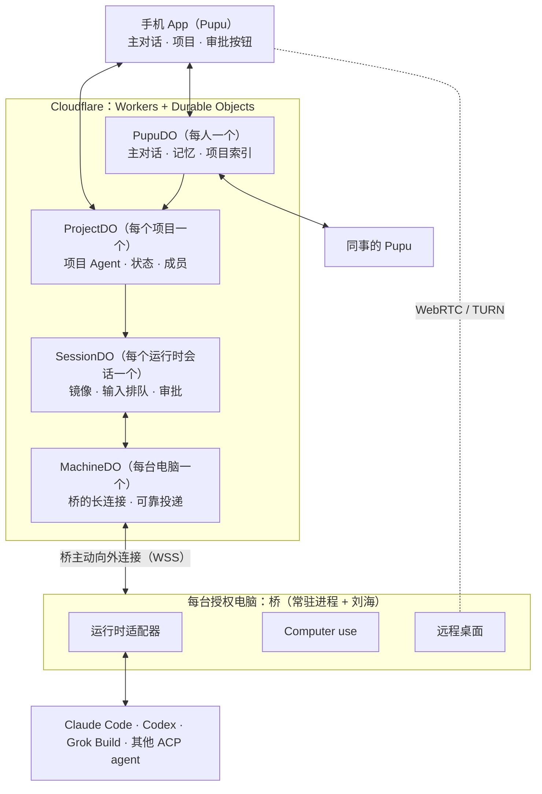

# Pupu 需求说明 v0.1

> 状态：需求澄清稿，2026-10-17。
>
> 本文记录三类内容，各条都标了来源：
> - **已确认**：用户拍板的；
> - **默认**：建议的默认设计，用户没有反对，有异议可改；
> - **待定 / 待验证**：还要用户回答，或者要实测。
>
> 技术事实是 2026-10-16 查官方文档和源码得到的，来源列在第 10 节。

## 1. 一句话

Pupu 是一个常驻在云端的个人 Agent，手机就是 Pupu。你和它保持一条长期对话，它替你在多台电脑上调度 Claude Code、Codex、Grok Build 等运行时。它接上的是正在进行的会话，而不是另起一个；它还能直接操作电脑，把工作闭环做完整。

## 2. 要解决的问题

- 离开工位后，进行到一半的工作没法顺畅地接着做。
- 官方的远程方案（Claude Code Remote Control、Codex Remote）各管各的运行时，而实际工作经常要几个运行时一起配合。
- 另起 session 实现简单，但之前的上下文用不上。我们要的是接上那个正在进行的会话。

## 3. 核心场景

1. **接着聊同一个会话**：在工位上跟 Claude Code 聊到一半，人离开了。在手机上对 Pupu 说"继续刚才那个"，Pupu 就接上同一个 Claude Code 会话把任务做完，进展会回到对话里。
2. **跨运行时接力**：Claude Code 写完代码后，Pupu 让另一台电脑上的 Codex 做 review，把意见交回给 Claude 修改，最后自己打开应用点一遍做验证。
3. **操作电脑完成闭环**：Pupu 在授权给它的电脑上把应用跑起来、看效果、点系统弹窗，完成命令行做不到的那部分。
4. **团队协作**：把项目共享给同事，同事的 Pupu 能看到进展，授权后还能推进。两个 Pupu 之间可以直接对话。

## 4. 产品形态

### 4.1 手机 App 就是 Pupu（已确认）

- 每个用户有一个 Pupu。它是云端的一个 Durable Object 实例，里面跑 pi-durable。手机关掉，它照样在运行。
- 交互参考 Hark Pro，分两个 tab：
  - **主对话**：一条长期对话，不区分新旧会话。
  - **项目**：一组项目会话，由 Pupu 引导建立，或者用户手动建立。
- 审批做成 Action Button（默认）：出现在对话和推送里，一键批准或拒绝。
- 主动汇报（默认）：进展按节奏推进对话里，不刷屏。

### 4.2 主对话（已确认）

- 一次性的小事直接办，比如查个东西、跑一条命令。
- 需要持续推进的事：优先建议放进已有项目，没有合适的再建议新建。
- 以上都只是建议。用户可以要求所有任务都留在主对话里。
- 用户聊到已有项目的事，Pupu 会建议转到那个项目里去聊。

### 4.3 项目（已确认）

- 一个项目就是一个持续运行的项目会话（项目 Agent）。用户在项目里也是跟 Pupu 说话。
- 全程由 Pupu 代办：它负责跟项目相关的运行时沟通，用户不直接跟 Claude 说话。需要原话转达时，让 Pupu 照原话转过去。
- 一个项目可以涉及一两台电脑，以及电脑上的多个运行时会话。
- 用户在工位上自己开的会话：桥上报之后，Pupu 会建议它该归到哪个项目，点一下就归进去。这只是建议，不强求，会话也可以不归进任何项目。
- 项目里能看到各运行时在干什么（默认）：以可展开的卡片显示正在改哪个文件、在跑什么命令、实时输出等，只能看，不能操作。

### 4.4 运行时会话接入（已确认要求 L2）

接入有三个级别：

| 级别 | 含义 |
|---|---|
| L0 只读 | 能看到会话在做什么 |
| L1 同一段历史 | 用会话 ID 接着聊，但跑在另一个进程里 |
| L2 同一个活进程 | 手机和工位终端是同一个进程的两个窗口，回到工位直接接着用 |

**目标是 L2。** 各运行时的做法如下：

| 运行时 | 做法 | 条件 / 限制 |
|---|---|---|
| Codex | 桥连接本机共享的 app-server 守护进程（Unix socket），对正在运行的会话调用 `thread/resume`，就能接上正在进行的输出，挂起的审批也会重放过来 | 0.157 起 TUI 默认使用这个守护进程。协议标注为 experimental |
| Claude Code | 用 `pupu claude` 或从刘海启动，带上 Channels（一个 MCP server 往运行中的会话推消息，也能代答权限请求）。审批走全局配置的 `PermissionRequest` hook | Channels 还是 research preview，必须在启动时带上，已经在跑的会话补不上。没带 Channels 的会话有两种办法：试 inbox socket（效果待测），或者照 Happy 的做法"停掉进程，再用 SDK resume" |
| Grok Build | 用 `grok agent serve` 或 `grok agent headless --grok-ws-url` 启动，原生支持 ACP | 默认的 TUI 从外部接不进去 |
| 其他（Gemini CLI、OpenCode、Cursor 等） | 用 ACP 的 `session/load` | 只能做到 L1 |

桥内部的统一做法（已确认）：

- 统一采用 ACP 的会话模型，包括 list、load、prompt、cancel、request_permission、update。
- Claude Code 和 Codex 各写一个原生适配器，其余运行时都走通用的 ACP 适配器。
- 读会话时不解析运行时的内部格式：
  - Claude Code 用 Agent SDK 的 `getSessionMessages`；
  - Codex 用 app-server 的 `thread/read`；
  - Grok Build 的 `updates.jsonl` 本身就是 ACP 事件流。

### 4.5 电脑是 Pupu 的工作环境（已确认）

- 任何授权给 Pupu 的电脑都可以用，思路和 Grok Bot 一样。
- 用日常电脑时：人离开时不锁屏，由 Pupu 接管屏幕。刘海上一直显示"Pupu 正在操作"，一键就能收回控制权。
- 人正在用这台电脑时（默认）：Pupu 只跑命令行和运行时；如果要动屏幕，先在刘海上请示。
- 刘海的定位：它是 Pupu 在这台电脑上的"在场标识"，显示：
  - 各运行时的状态；
  - Pupu 是否正在操作屏幕；
  - 一键收回的入口。
- Computer use 的实现参考 Cindy：把 cua-driver 包装成 MCP，并负责协调"现在是人还是 Pupu 在控制输入"。
- 远程桌面也参考 Cindy：
  - 视频走 WebRTC，输入走有序的 DataChannel；
  - 使用短期有效的 TURN 凭证；
  - 连不通时，通过中继发 JPEG 兜底；
  - 同一时间只有一个人控制，其他人可以接管。
- 视频流不经过 Durable Object。

### 4.6 自主权限（已确认：分级）

| 自动执行 | 弹按钮确认 |
|---|---|
| 在已有项目里推进任务 | 开新的运行时会话 |
| 低风险审批，比如读文件、跑测试 | 动用另一台电脑 |
| | 高风险命令，比如删除、push、发布 |
| | 高风险的界面操作，比如发消息、付款（默认） |

### 4.7 协作（已确认）

- 每人一个 Pupu，协作靠共享项目。
- 共享项目默认只读，驾驶权由项目所有者按项目授予。
- Pupu 之间可以聊天，不限于共享项目。比如可以问"Alice 今天在忙什么"，对方的 Pupu 按主人的**透露设置**决定说多少。透露设置默认保守：只说项目名和进度，不说对话内容。
- 别人的 Pupu 请求动用你的电脑时（默认），按你的权限分级处理，超出范围要你确认。

**Pupu 之间的通信设计**（默认，参考 Reason Network，见第 10 节）：

1. **按"人/对象"寻址。** Pupu 之间、项目之间的消息都用统一的地址格式：
   - `alice/pupu`：Alice 的 Pupu；
   - `alice/登录改版`：Alice 的一个项目；
   - `alice/工位Mac/claude-xxx`：Alice 某台电脑上的一个运行时会话。
2. **在场状态从 agent 自身提取。** 包括谁在做什么、忙还是闲、在哪个仓库哪个分支，从各运行时会话的标题和 todo 列表里取，再汇总到项目状态里。别人问"Alice 今天在忙什么"时，按这份状态回答，回答前先经过透露设置过滤。
3. **靠可见性避免冲突，不加锁。** Pupu 派活之前，先查这个仓库或分支现在有没有人的 agent 在动：
   - 有，就去问那个 agent，或者问它的主人的 Pupu，不重复动手；
   - 冲突无法避免时，提醒双方的主人。
4. **消息按线程组织。** Pupu 之间的消息是一段段对话，不是一条条孤立的消息：
   - 支持"问了就等答复"，后续追问接在同一线程里；
   - 双方主人都能看到线程记录。

Reason Network 本身不直接采用，原因有三：
- 它是点对点网络，而 Pupu 在云端，DO 之间直接调用即可；
- 它让运行时之间直接对话，而 Pupu 定的是全程代办；
- 它没有透露设置和权限分级。

以后如果有同事用 Reason Network 而不用 Pupu，可以让桥加入它的网络来互通，优先级低。

### 4.8 部署（默认）

- 先给自己和团队用，部署在自己的 Cloudflare 账号上。
- 信任云端：云端 Agent 可以读明文，不做端到端加密。
- 团队在海外办公（已确认），不需要考虑大陆网络的限制。

## 5. 架构

- **PupuDO**：用 pi-durable（PiHarness）跑主对话。另外还管长期记忆、项目索引，以及 Pupu 之间的消息收发。
- **ProjectDO**：每个项目对应一个 pi-durable 会话，持续运行，持有项目上下文，并驱动项目里的运行时会话。项目共享和成员也由它管。
- **MachineDO**：持有桥建立的长连接。投递带序号和确认，参考 Cindy 的 device-link。
- **SessionDO**：负责会话镜像，把事件日志存进 SQLite 并广播出去；多人输入在这里串行执行；也负责处理待审批项和"谁在驾驶"。
- **桥**：常驻进程是本体，刘海只是它的一个界面。桥主动向外连云端，电脑上不开端口。
- **MCP 的用法**：桥上的能力（会话、屏幕、键鼠）包装成工具，通过桥已有的出站连接反向提供给云端 Agent。原因是 Cloudflare Agents SDK 的 MCP client 会拦截内网 IP。
- **长期对话的记忆分层**：完整记录存在 SQLite 里，每一轮只带三样东西：最近的对话、各活跃项目的摘要、检索到的相关内容。
- **推送**：部署后的 Worker 直接 fetch APNs，用 ES256 JWT 签名。这是社区实测可用的行为，不是官方保证；本地 `wrangler dev` 下无效。

## 6. 和已有产品的区别

"用手机遥控本机 coding agent"这件事，已经有不少产品在做：

- **官方方案**：Claude Code Remote Control、Codex Remote，各自只支持自家的运行时。
- **第三方遥控**：Happy、HAPI、Paseo、Cindy。基本做法是本机常驻进程 + 中继 + 手机端。
- **刘海状态类**：Vibe Notch、CodeIsland、Coucou、Vibe Island，都是基于 hooks 实现的。

所以"看会话、回消息、刘海显示状态"只是基础功能。Pupu 的差异在于：

1. 有一个常驻的 Agent，配合项目会话，全程替你代办；
2. 真的能接上正在进行的会话；
3. 跨电脑、跨运行时完成同一件事，并且能直接操作电脑；
4. 每人一个 Pupu，可以共享项目，Pupu 之间也能对话。

基础遥控能复用就复用：Cindy、CodeIsland、Coucou 都是 Apache-2.0 或 MIT 协议。

## 7. 风险与约束

- **合规**：Anthropic 不允许第三方产品提供 Claude.ai 登录，不允许借用户的订阅额度转发请求，也不允许收集或中转 Claude 的凭证。由桥去驱动用户自己登录的官方 CLI 没有问题，但不能碰 `~/.claude` 里的凭证。云端 Agent 调用 Claude 要用 API key，按量付费。
- **依赖预览或实验性接口**：Claude Channels（research preview）、Codex app-server（experimental）、pi-durable（experimental）、PiHarness（beta）。所以适配器层要能替换，锁定版本，并写契约测试。
- **PiHarness 目前的缺口**：
  - 没有工具审批环节，要自己用 `beforeTool` 拦截；
  - 客户端重连只能拿到快照，不能按游标接着读；
  - 超过 15 分钟的模型流可能被切断。

  另外要注意：发消息、批准这类工具不能标成 `replay:"safe"`，桥那边也要按 requestId 去重。
- **不锁屏的安全风险**：日常电脑离开时不锁屏，存在安全风险。锁屏后，基于截图和点击的操作基本做不了（待实测）。
- **电脑必须醒着**：要防止睡眠。电脑离线时，云端要把输入先排队存着。
- **成本**：computer use 的截图很费 token；长期对话和多个项目 Agent 同时在跑，模型费用也要提前估算。

## 8. 建议的落地顺序

0. **技术验证（1–2 周）**：验证核心场景能端到端跑通——在手机上对 Pupu 说"继续刚才那个"，它能接上工位上的 Claude Code 会话。
   - 桥：能列出会话；能以 L2 接上 Codex 会话（app-server）和 `pupu claude` 启动的 Claude Code 会话（Channels）；权限请求能推到手机，审批结果能回传。
   - 云端：最小可用的 PupuDO（跑 pi-durable）和 MachineDO。
   - 手机端：先用网页。
1. **MVP（自用）**：
   - 手机 App：主对话、项目 tab、审批按钮、推送；
   - 项目会话：Pupu 引导建项目，并建议工位会话归到哪个项目；
   - 支持多台电脑；
   - 刘海：显示状态、做审批、在场标识；
   - 权限分级。
2. **Computer use**：
   - Pupu 能操作授权的电脑；
   - 人和 Pupu 之间的输入控制权协调，刘海一键收回；
   - 远程桌面。
3. **协作**：共享项目、驾驶权、审计日志；Pupu 之间聊天，支持透露设置。

第 2、3 步的先后可以调换。这里建议先把一个人的闭环做完整，再做协作。

## 9. 待定与待验证

**待定（需要用户回答）**

- 授权电脑是否也包括云端机器。Grok Bot 就是每个 bot 配一台持续存在的云电脑。
- 手机端先做 iOS 还是双端，用原生开发还是跨平台。
- Pupu 用哪家模型，预算多少。
- 透露设置的默认值、项目归档规则。

**待验证（需要实测）**

- 锁屏之后，GUI 操作是否还可行；虚拟机是否不受宿主锁屏的影响。
- 用 Claude Code inbox socket 往运行中的会话发消息，实际效果如何。
- Channels 和 Codex app-server 在版本升级后是否稳定。
- 在 Workers 里发 APNs 是否稳定。

## 10. 参考

**运行时**

- Claude Code：
  - [Sessions](https://code.claude.com/docs/en/sessions)
  - [Channels](https://code.claude.com/docs/en/channels)
  - [Remote Control](https://code.claude.com/docs/en/remote-control)
  - [Hooks](https://code.claude.com/docs/en/hooks)
  - [Cross-session messaging](https://code.claude.com/docs/en/cross-session-messaging)
  - [Agent SDK](https://code.claude.com/docs/en/agent-sdk/overview)
  - [合规说明](https://code.claude.com/docs/en/legal-and-compliance)
- Codex：
  - [app-server](https://learn.chatgpt.com/docs/app-server)
  - [app-server 守护进程](https://github.com/openai/codex/blob/main/codex-rs/app-server-daemon/README.md)
  - [Remote connections](https://learn.chatgpt.com/docs/remote-connections)
- Grok Build：
  - [Agent mode](https://github.com/xai-org/grok-build/blob/main/crates/codegen/xai-grok-pager/docs/user-guide/15-agent-mode.md)
  - [Headless](https://docs.x.ai/build/cli/headless-scripting)
- ACP：
  - [方法列表](https://github.com/agentclientprotocol/agent-client-protocol/blob/main/schema/v1/meta.json)
  - [注册表与兼容矩阵](https://github.com/agentclientprotocol/registry)

**云端**

- [pi-durable 发布文章](https://earendil.com/posts/pi-durable/)
- [pi-durable README](https://github.com/earendil-works/pi/blob/main/packages/durable/README.md)
- [PiHarness](https://developers.cloudflare.com/agents/harnesses/pi/)
- [DO 限制](https://developers.cloudflare.com/durable-objects/platform/limits/)
- [DO WebSocket](https://developers.cloudflare.com/durable-objects/best-practices/websockets/)
- [Agents 持久执行](https://developers.cloudflare.com/agents/api-reference/durable-execution/)
- [Agents MCP client](https://developers.cloudflare.com/agents/model-context-protocol/apis/client-api/)
- [Cloudflare Realtime](https://developers.cloudflare.com/realtime/)
- [在 Workers 里发 APNs 的讨论](https://github.com/cloudflare/workerd/issues/4841)

**同类产品**

- [Happy](https://github.com/slopus/happy)
- [HAPI](https://github.com/tiann/hapi)
- [Paseo](https://github.com/getpaseo/paseo)
- Cindy：
  - [device-link](https://github.com/makecindy/cindy/blob/main/packages/device-link/README.md)
  - [远程桌面](https://github.com/makecindy/cindy/blob/main/docs/remote-desktop.md)
- [CodeIsland](https://github.com/wxtsky/CodeIsland)
- [Coucou](https://github.com/Louis-CFM/coucou)
- [Vibe Notch](https://github.com/farouqaldori/vibe-notch)
- Reason Network：[介绍页](https://reasonmachines.com/network)、[GitHub](https://github.com/reason-machines/reason-network)、[发布推文](https://x.com/reasonmachines/status/2111135100142518430)

**交互参考**

- Hark Pro：
  - [官方介绍](https://hark.com/articles/introducing-hark-pro)
  - [上手评测](https://aiprofitboardroom.com/blog/hark-ai-agent/)
- Grok Bot：
  - [报道](https://interestingengineering.com/ai-robotics/xai-grok-bot-computer-agent)
  - [介绍](https://www.mindstudio.ai/blog/grok-bot-ai-agent-fleet/)

## 附：术语

| 术语 | 含义 |
|---|---|
| Pupu | 每个用户在云端的个人 Agent。一个 DO 实例，里面跑 pi-durable |
| 主对话 | 跟 Pupu 的一条长期对话 |
| 项目 / 项目会话 | 一个持续运行、由 Pupu 代办的项目级对话 |
| 运行时 | Claude Code、Codex、Grok Build 这类 coding agent |
| 运行时会话 | 某个运行时里的一个 session |
| 桥 | 每台电脑上的常驻进程，连接云端和本机运行时。刘海是它的一个界面 |
| 授权电脑 | 允许 Pupu 使用的电脑，是 Pupu 的工作环境 |
| 驾驶权 | 能向项目或会话发指令、做审批的权限 |
| 透露设置 | 你的 Pupu 可以向别人的 Pupu 透露哪些信息 |
| L0 / L1 / L2 | 运行时会话的接入级别：只读 / 同一段历史 / 同一个活进程 |
