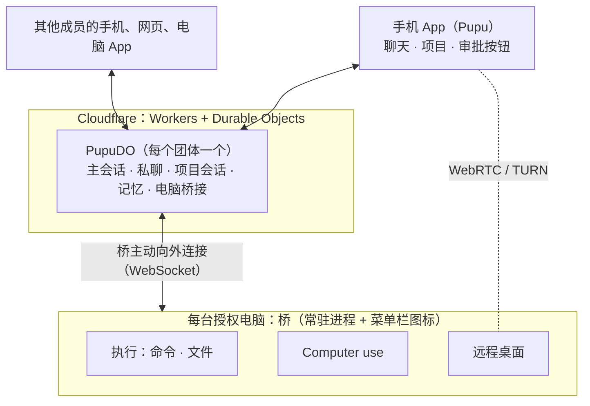

# Pupu 需求说明 v0.3

> 状态：需求澄清稿。v0.1 写于 2026-10-17，v0.2 修订于 2026-10-24，v0.3 修订于 2026-11-03，2026-11-05 补充。
>
> v0.3 的主要变化：
> - **新账号自己开一个 Pupu（2026-11-07）。** 别人靠链接就能用起来，先放前 20 名。默认一人一个，创建者邀请谁，谁就进他的 Pupu。见 4.7。
> - **一个团体共用一个 Pupu。** 一家人或一个团队只有一个 Pupu，每人用 Google 账号登录，主会话和项目都是大家共用的；电脑挂在各人账号下，按主人开放的权限给别人用。原来的「每人一个 Pupu、Pupu 之间聊天」作废。见 4.7。
> - **每人多一条私聊（2026-11-05）。** 聊天分主会话和私聊，主会话是默认入口，私聊只有本人和 Pupu，创建者也不能读。没有云端总主会话。见 4.7。
> - **项目切换改成 Hark 的做法（2026-11-05）。** 左上角打开整页项目列表，不再用底部面板。见 4.1。
> - **去掉主页（2026-11-05）。** 一级导航只留聊天和项目，打开直接进聊天。「正在做」挪到聊天顶部，项目进展挪到项目列表，电脑在线状态只在设置里。和 Hark 不一致是有意的：Hark 的主页放对话生成的面板，Pupu 没有。见 4.1。
>
> v0.2 的主要变化：
> - **不再接 Claude Code、Codex 等本地运行时。** Pupu 自己就是干活的 Agent，常驻云端，把授权的电脑当执行环境用：跑命令、读写文件、操作屏幕。做法参照 Grok Bot，拆解见 `docs/调研/grok-bot-本地执行拆解.md`。
> - **交互改为参考 Hark。** 主页、聊天、项目三屏；建项目用一句话确认；聊天把事转交给项目。
>
> 本文记录三类内容，各条都标了来源：
> - **已确认**：用户拍板的；
> - **默认**：建议的默认设计，用户没有反对，有异议可改；
> - **待定 / 待验证**：还要用户回答，或者要实测。

## 1. 一句话

Pupu 是一个常驻在云端的个人 Agent，手机就是 Pupu。你和它保持一条长期对话，它自己动手干活：在你授权的电脑上跑命令、读写文件、操作屏幕，把事情做完。电脑只是它的执行环境，人的交互入口只有 Pupu。

## 2. 要解决的问题

- 离开工位后，进行到一半的工作没法顺畅地接着做。电脑上的 agent 都要人守在旁边。
- 遥控本机 coding agent 的方案，本质是把终端搬到手机上，人还得自己一个个驱动会话。
- 我们要的是：只跟一个常驻的 Pupu 说话。它记得所有上下文，自己在电脑上把事做完；电脑掉线了，它也还在。

## 3. 核心场景

1. **离开工位接着推进**：在手机上对 Pupu 说"继续刚才那个"，Pupu 接着在工位电脑上跑命令、改代码，进展回到对话里。上下文都在云端，不依赖哪个终端开着。
2. **多台电脑配合**：Pupu 在一台电脑上改完代码，再到另一台上跑测试或部署。
3. **操作电脑完成闭环**：Pupu 在授权给它的电脑上把应用跑起来、看效果、点系统弹窗，完成命令行做不到的那部分。
4. **一个团体共用一个大脑**：家里或团队的几个人用各自的 Google 账号登录同一个 Pupu。主会话和项目大家共用，私事可以放进自己的私聊；Pupu 按各人开放的权限用大家的电脑。

## 4. 产品形态

### 4.1 手机 App 就是 Pupu（已确认）

- 每个用户有一个 Pupu。它是云端的一个 Durable Object 实例，里面跑 pi-durable。手机关掉，它照样在运行。
- 交互参考 Hark（2026-10-23 确认），分两屏，打开直接进聊天（已确认，2026-11-05）：
  - **聊天**：长期对话，不区分新旧会话。分主会话和私聊两条，见 4.7。顶部是「正在做」：有电脑在干活、等批准或屏幕控制没收回时显示，带「收回」；没有就不占位；
  - **项目**：直接打开上次的项目会话，左上角 ≡ 打开整页项目列表，用来切换和新建。列表里写每个项目的最新进展，停着等批的标「等你批准」。
- 「正在做」和审批卡一样把内容往下挤，不盖住对话。多台电脑时只摊开第一行，屏幕控制没收回的排在最前，其余收在 +N 里。手机上灵动岛被划掉后，这里是收回屏幕控制的入口（默认）。
- 电脑在线状态只在设置 → 电脑里看（已确认，2026-11-05）。
- **iOS App（已确认，2026-10-30）**：用 UIKit 原生做，最低 iOS 26。设计规范在 claude.ai 的「[Pupu 设计规范](https://claude.ai/artifact/Uzkik3Ma7C9zXpYHqxsEjE)」，写界面前先读它的 README。下面几条已确认：
  - 一级导航是顶部的两段切换，底部留给输入栏；
  - 聊天这一段就是 Pupu：写着头像和当前那条聊天（大家或私聊），没有下拉箭头。在别的页面点一下回到聊天，长按弹出大家和私聊的切换，不加第一次使用的引导（已确认，2026-11-05）；
  - 切换项目照 Hark 做（已确认，2026-11-05）：左上角 ≡ 打开整页列表，对话和输入栏隐去，顶栏不动；第一行「新项目」，当前项目加粗。选中后列表淡出，转圈，进新项目。两段下方有一个写项目名的小胶囊，只显示，不能点。原地换整页，不是左侧抽屉，不和返回手势冲突；
  - 主操作沿用墨色，不加品牌色；
  - 做灵动岛和锁屏实时活动，和 Mac 菜单栏图标对应：显示 Pupu 在哪台电脑上做什么，在锁屏上就能批准、能收回。
- 长按消息可以复制、引用回复。
- 审批做成按钮（默认）：出现在对话和推送里，一键批准或拒绝。
- 主动汇报（默认）：进展按节奏推进对话里，不刷屏。

### 4.2 聊天（已确认）

- 一次性的小事直接办，比如查个东西、在电脑上跑一条命令。
- 属于已有项目的事：Pupu 转交给那个项目去做，结果发在项目里。聊天里的回复上方挂一个项目标签，点一下就过去。
- 需要持续推进、又没有合适项目的事：Pupu 用一句话问要不要建项目，用户答应了才建。
- 用户说就在聊天里做，就在聊天里做，不反复劝。

### 4.3 项目（已确认）

- 一个项目就是一个持续运行的项目会话。用户在项目里也是跟 Pupu 说话。
- 一个项目可以用到一两台电脑。
- 项目里能看到 Pupu 在电脑上干了什么（默认）：以可展开的卡片显示跑了什么命令、改了哪个文件、实时输出等，只能看。

### 4.4 电脑是 Pupu 的执行环境（已确认，2026-10-24）

- **不接本地运行时。** Agent 的回合只在云端跑，电脑只提供执行能力，和 Grok Bot 一样。人的交互入口只有 Pupu 本体。
- **任何授权给 Pupu 的电脑都可以用。** 一个 Pupu 可以同时用好几台，每个动作指定在哪台上做。
- **执行能力分两批：**
  - 第一批：跑命令，包括前台流式输出、放到后台运行并把输出写成文件、往运行中的命令写输入；读写文件、列目录、传文件；
  - 第二批：截图和操作屏幕，见 4.5。基本动作（截图、点击、移动、拖动、滚动、打字、按键）已经接到桥上，操作前先在手机上请示屏幕授权，电脑菜单栏上有状态图标。远程桌面第一版也做了，也见 4.5。
- **电脑掉线时，Pupu 照常对话，只是用不了这台电脑。** 它会如实告诉用户，等电脑回来再做。
- **桥：** 每台电脑上一个常驻进程，主动向外连云端，电脑上不开端口。每台电脑一个设备凭据，可以单独吊销。

### 4.5 操作屏幕（已确认）

**不做刘海，改成菜单栏图标（已确认，2026-10-30）。** 图标只显示状态、给一键收回的入口；请示一律在手机上批。

现状（2026-10-30）：截图和键鼠前先在手机上批「屏幕授权」，批一次之后 15 分钟没有屏幕操作才会再问；菜单栏图标已经做了。还没做的是：判断人是不是正坐在这台电脑前用它。

现状（2026-11-04）：手机远程桌面第一版做了。入口在「我」→ 电脑 → 这台电脑，只有电脑主人的手机能看到和连上，打开前要过 Face ID。视频走 WebRTC（H.264，Mac 上硬件编码），输入走有序的 DataChannel，有触摸和触控板两种操作方式。人在手机上操作时，Pupu 的屏幕动作等人停手 300 毫秒再做，最多等 5 秒。菜单栏显示手机正在查看或控制这台电脑，可以一键断开。

- 用日常电脑时：人离开时不锁屏，由 Pupu 接管屏幕。菜单栏图标一直显示"Pupu 正在操作屏幕"，一键就能收回控制权。
- 人正在用这台电脑时（默认）：Pupu 只跑命令；如果要动屏幕，先在手机上请示。
- 菜单栏图标是 Pupu 在这台电脑上的"在场标识"。图标分五种状态：没连上、空闲、在跑命令、操作屏幕、等批准。菜单里有：
  - Pupu 是否在用这台电脑、在跑什么命令（最多列 5 条）、有哪些在等批准；
  - 「收回屏幕控制」：作废屏幕授权，拒掉这台电脑还在等的屏幕请示；
  - 「停止正在跑的命令」；
  - 本机开关「允许跑命令和写文件」「允许操作屏幕」，见 4.6。
- 已经落地的截图和键鼠，按 Grok Bot 的方式做：先截图，再用图上的像素坐标点、拖、滚动和打字。后面的输入控制权交接仍参考 Cindy：把 cua-driver 包装成工具，并协调"现在是人还是 Pupu 在控制输入"。
- 远程桌面也参考 Cindy：
  - 视频走 WebRTC，输入走有序的 DataChannel；
  - 使用短期有效的 TURN 凭证；
  - 连不通时，退到 JPEG 兼容模式：一次只传一帧，每秒最多 4 帧，长边最多 1280；
  - 同一时间只有一台手机连着，主人的另一台手机要手动接管。
- WebRTC 视频不经过 Durable Object。JPEG 兼容模式第一版走 PupuDO，帧率和大小都限死了，真不够用再拆单独的中继。

### 4.6 自主权限（已确认：分级）

| 自动执行 | 弹按钮确认 |
|---|---|
| 在已有项目里推进任务 | 动用另一台电脑 |
| 低风险动作，比如读文件、列目录、跑测试 | 高风险命令，比如删除、push、发布 |
| | 高风险的界面操作，比如发消息、付款（默认） |

云端和电脑各判一次（默认，参照 Grok Bot）：
- 云端按分级决定要不要问人；
- 电脑上按本机的开关再判一次，本机可以拒绝云端已经批准的动作。

现状（2026-10-30）：
- 每台电脑一个分级，在设置「电脑」页每台电脑右边的下拉里改（2026-11-13 照 Grok Bot 改）：
  - 「始终允许」（2026-11-13 起新配对的电脑默认）：命令、写文件、屏幕、浏览器（内网、提交、下载）都不出审批卡，屏幕不用批授权、也不会过期；
  - 「高风险时询问」（之前的默认，已配对的电脑保留）：高风险的单独问，屏幕按电脑批一次授权；
  - 「每次询问」：跑命令、写文件、写输入、点屏幕、浏览器里会动页面的，每一步都问，读文件不问。
  - 主人在任何登录着的端（手机、网页、电脑 App）都能直接改，不用手机或通行密钥再确认；别的成员只能往严里改。改成「始终允许」时，这台电脑还挂着的审批卡一起放行。
  - 不管哪档都不做的：点系统的授权和密码窗口（桥上拦），改 macOS 隐私权限（`tccutil`、`com.apple.TCC`，云端和桥上各拦一次）；本机菜单栏的开关照样能拒。
- 高风险的判定规则在 `apps/cloud/src/bridge/policy.ts`，云端和桥共用：
  - 命令：删除、提权、`git push` 和丢改动的 git 操作、发布包、部署（包括名字里有 deploy、publish、release 的脚本）、结束进程、关机、改系统设置和开机启动项、AppleScript、钥匙串、下载脚本直接执行、写系统目录、碰凭据和密钥；
  - 文件：写主目录根下的点文件和凭据目录，读私钥和各类凭据；
  - 屏幕：点击、拖动、打字、按键这一步会发消息、付款、提交或删除时，模型要标 `sensitive`，这一步单独问。
- 审批卡片挂在网页每一屏的顶部，一键允许或拒绝。10 分钟没人处理就作废。
- 本机开关在菜单栏上改，存在 `~/.pupu/local.json`。高风险动作和屏幕操作，桥只认云端说批过的。
- 「动用另一台电脑」要确认，还没做。

### 4.7 一个团体共用一个 Pupu（已确认，2026-11-03）

用户原话：「pupu我想做成共享的，场景是组织大脑或者家庭大脑。一个团体只需要一个大脑就够了，这样能够做不同的事情，大家都很方便。Pupu云端——第一公民，人类——第二公民多个账号共同与这个pupu聊和做事，各种电脑——第三公民，被Pupu调用。」

v0.2 的「每人一个 Pupu、Pupu 之间聊天、按透露设置决定说多少」作废。不同团体的 Pupu 要不要互通，以后再说；原来参考 Reason Network 的通信设计见 v0.2。

**三类公民**
- Pupu 是第一公民：一个团体（一家人、一个团队）一个，常驻云端。
- 人是第二公民：每人用自己的账号登录，一起和 Pupu 聊、让它做事。
- 电脑是第三公民：挂在某个人的账号下面，被 Pupu 调用。

**账号和成员**（已确认）
- 只用 Google 账号登录，邮箱在成员名单里才放行。登录代替原来的配对码，配对码和访问口令留作后备。
- 不在任何 Pupu 里的新账号，第一次登录时开一个自己的 Pupu，成为创建者（2026-11-07，用户原话「如果我拉别人进我的空间，那么就多人用的就是我的pupu」）。一个账号只住一个 Pupu，已经有自己 Pupu 的账号邀请不进来。
- 内测限人数：名额按人算，被邀请的人也占，第一个 Pupu 的成员不占。
- 开新 Pupu 要邀请码：一个码开一个 Pupu，第一个 Pupu 的创建者在设置里生成。被邀请的成员不用码。满了之后新账号进不来，引导去官网申请。每个 Pupu 每天有模型费用上限，第一个 Pupu 不限。新开的 Pupu 先不开连接器。
- 角色只有两种：创建者和成员。创建者邀请和移除成员（默认）。
- 手机、网页、电脑 App 都挂在登录的那个人名下，看得出哪台设备是谁的，可以单独吊销。

**会话：主会话和项目公开，每人一条私聊**（已确认，2026-11-05，用户原话「中间 tab，也就是会话，是不是可以切换私聊和主要会话聊天？」。改了 2026-11-03 的「都是公有的，没有私聊」）
- 主会话（聊天里的「大家」）只有一个，团体里的人共用，像一个大家和 Pupu 一起的群聊。它是默认入口，组织的事放这里，大家都看得到。
- 项目会话也是公开的，团体里的人都能看、都能在里面说话。
- 每人有一条私聊，只有本人和 Pupu。私事和没想好的事放这里，不用排在主会话后面。
- 创建者也不能读别人的私聊（已确认）。这是产品里看不到；部署的人技术上能读数据库，对外要说清楚。
- 没有云端总主会话：创始人看全局，在主会话或自己的私聊里问，Pupu 读公开的项目来答。私有项目先不做（已确认）。
- 私聊里的话不会自己流到别处。转交给项目、建项目时内容会公开，Pupu 要先说清楚（默认）。
- 私聊发起的电脑动作，审批卡和电脑状态只给发起人和批准这一步的人看（默认）。
- 切到私聊时背景换成夜空，一眼分得出在哪条线上（默认）。深色模式下要另想办法（待定）。
- 每条消息记着是谁发的。Pupu 的每一轮都记在「替谁做」名下，也就是发起这一轮的人（默认）。定时任务和主动消息，算设置它的那个人（默认）。

**电脑跟着账号走**（已确认）
- 一个人的账号下面可以有几台电脑：用谁的账号登录电脑 App，这台电脑就是谁的。
- 每台电脑由主人决定别人能不能用，分三档：
  - 从不：别人发起的请求用不了这台电脑；
  - 每次问（默认）：别人发起的，先在主人手机上问一次，卡片写清替谁做、要做什么；批了，这一轮里就可以用（默认）；
  - 总是允许：别人发起的不再先问。
- 不管哪一档，这台电脑自己的分级（4.6）照样生效，高风险的动作照样单独问主人（默认）。主人自己发起的，只按 4.6 的分级走。
- 这台电脑的批准只发到主人的手机上。放宽权限只能在主人的手机上改，收紧在哪里都能改（默认，延续「审批只认手机」）。

**记忆：个人和共享分开**（三层分法已确认，2026-11-03。参考 Grok Bot 0.78 的 Team Bot，见 `docs/调研/grok-bot-权限拆解.md` 7.2 节）

先不做，要先调研清楚（已确认，2026-11-04）。有了私聊，下面「成员都能看到每个人的个人记忆」要重新定（待定）。

记忆分三层：

| | 从哪来 | 哪些轮能用 |
|---|---|---|
| 个人记忆 | 关于某一个人的事，比如他的习惯、偏好、常用的电脑 | 他自己发起的轮 |
| 项目记忆 | 项目会话里定下的事和进展 | 这个项目里的每一轮 |
| 共享记忆 | 关于整个团体的事，比如各人管什么、家里的地址和习惯、团队的规矩 | 所有的轮 |

会话都公开以后，个人记忆不再是「私事」，而是「关于这个人的事」（已确认，2026-11-03）：
- 每一轮只装发起人的个人记忆，免得把张三的习惯用在李四身上。
- 成员都能看到每个人的个人记忆，本人能改、能删。
- 进共享记忆有两条路：一是项目里定下的、对整个团体有用的事；二是有人明说「记下来，大家都要知道」。
- **共享记忆的变动看得见。** 每加一条、删一条，对话里都留一行提示；每条记着谁加的、从哪来的。成员都能看全部共享记忆，能删改的是加的人和创建者（默认）。
- **成员被移除时**，他的个人记忆一起删；他在会话里说过的话和他加进共享记忆的留着（默认）。

### 4.8 账户：连接器（要做，2026-11-04）

用户原话：「我想加连接器怎么没有入口呢」「要做，然后右上角的我的页面点击进去的页面也对标 hark」。

让 Pupu 用成员自己的 Gmail、日历、GitHub 这些账号做事。入口在手机 App 右上角「我 → 账户」，页面排法参考 Hark 的账户页：上面是已经连上的账号，下面是能连的服务，每个服务一个「连接」按钮。

**第一批接的服务**（默认）：Gmail、Google 日历、Google 云端硬盘、GitHub。

**凭据放在哪**（默认）：单独部署一个 open-connector（开源，部署在自己的 Cloudflare 上），它管授权和凭据，Pupu 只记哪个账号是谁连的。凭据不进 Pupu 的数据库，也不进模型。

**账号跟着人走**（默认，和电脑一样）
- 谁连的账号就是谁的，「我 → 账户」里写着是谁连的。
- 连接只能在手机 App 上做，网页和电脑 App 上只能看（延续「放宽只在手机上」）。
- 断开：本人能断自己的，创建者能断任何人的。断开时在服务那边一起撤销授权。
- 成员被移除时，他连的账号一起断开。

**读和写分开**（默认）
- 读邮件、看日程、查 issue 这类读的动作，Pupu 直接做。
- 发信、建日程、改 issue 这类写的动作，先在账号主人的手机上批准，卡片写清用哪个账号、要做什么；删除和撤销类标成高风险。分不清读写的按写算。
- 同一个服务连了几个账号又没说用哪个，Pupu 先问。
- 用自己账号读到的内容放在本人的私聊里，不进主会话和项目（默认）。
- 别人发起的一轮能不能用你的账号，也该像电脑一样分三档（4.7）。现在还没记「这一轮替谁做」，先按上面的规则走，等记上了再加（待定）。

### 4.9 部署（默认）

- 先给自己和团队用，部署在自己的 Cloudflare 账号上。
- 信任云端：云端 Agent 可以读明文，不做端到端加密。
- 团队在海外办公（已确认），不需要考虑大陆网络的限制。

## 5. 架构

- **PupuDO**：用 pi-durable（PiHarness）跑对话。主会话是大家共用的根会话，每人的私聊和每个项目各是一个会话，共用这个 DO 的 SQLite。另外还管成员、长期记忆（分个人、项目、共享三层，见 4.7）和项目索引。项目多了、或者要共享项目时，再把项目拆成单独的 ProjectDO（默认）。
- **电脑桥接**：在 PupuDO 里，参照 Grok Bot 云端的 `SandLocalExecBridge`。
  - 每台电脑一条可休眠的 WebSocket；
  - 桥连上后先报电脑 id 和名字，之后靠心跳判断在线；
  - 每个请求带 requestId，结果流式返回，可以取消，有回包超时。
- **桥**：常驻进程是本体。菜单栏图标是它拉起的子进程，挂了桥会重启它；图标退出或升级，不会带走桥手上在跑的命令。
- **长命令的输出写成文件。** Pupu 用读文件去追，长任务不用占着连接，断线重连后也不丢输出。
- **工具的位置**：Pupu 的工具定义在云端，执行时经桥已有的出站连接发到电脑上。不用 MCP client 直连电脑，因为 Cloudflare Agents SDK 的 MCP client 会拦截内网 IP，而且电脑不开端口。
- **长期对话的记忆分层**：完整记录存在 SQLite 里，每一轮只带三样东西：最近的对话、各活跃项目的摘要、检索到的相关内容。
- **推送**：部署后的 Worker 直接 fetch APNs，用 ES256 JWT 签名。这是社区实测可用的行为，不是官方保证；本地 `wrangler dev` 下无效。

## 6. 和已有产品的区别

- **遥控本机 coding agent**：Claude Code Remote Control、Codex Remote、Happy、HAPI、Paseo、Cindy。人还是在驱动电脑上的 agent，手机只是遥控器。
- **刘海状态类**：Vibe Notch、CodeIsland、Coucou、Vibe Island，都是基于 hooks 实现的。
- **最接近的是 Grok Bot**：Agent 在云端，电脑是执行环境。

Pupu 的差异在于：

1. 手机优先，交互是一条长期对话加项目（参考 Hark），而不是一堆会话；
2. 跑在自己的 Cloudflare 账号上，模型自己选；
3. 一个团体共用一个 Pupu：主会话和项目都是大家共用的，每人还有一条私聊，电脑按主人开放的权限给别人用。

远程桌面能复用就复用：Cindy 是 Apache-2.0 或 MIT 协议。

## 7. 风险与约束

- **合规**：云端 Agent 调用 Claude 要用 API key，按量付费，不能借用户的 Claude 订阅。
- **依赖实验性接口**：pi-durable（experimental）、PiHarness（beta）。要锁定版本。
- **PiHarness 目前的缺口**：
  - 没有工具审批环节，已经用 `beforeTool` 拦截。等批准时 DO 被回收也没关系：pi 重跑这次调用的 `beforeTool`，按调用 id 查到同一条请示，接着等；
  - 客户端重连只能拿到快照，不能按游标接着读；
  - 超过 15 分钟的模型流可能被切断。

  另外要注意：跑命令、写文件这类工具不能标成 `replay:"safe"`，桥那边也要按 requestId 去重。
- **在日常电脑上直接跑命令**：Pupu 的命令直接跑在用户的电脑上，没有沙箱，靠权限分级和本机二次判断兜底。要不要提供隔离环境，比如 Grok Bot 的本地 Docker box，待定。
- **不锁屏的安全风险**：日常电脑离开时不锁屏，存在安全风险。锁屏后，基于截图和点击的操作基本做不了（待实测）。
- **电脑必须醒着**：要防止睡眠。电脑离线时，Pupu 要如实说明，等它回来再做。
- **成本**：computer use 的截图很费 token；长期对话和多个项目会话同时在跑，模型费用也要提前估算。

## 8. 建议的落地顺序

**已完成**：云端 Pupu 网页版，包括聊天、项目、转交、引用回复，2026-10-23 部署。

0. **电脑桥接**：在手机上对 Pupu 说一件要在电脑上做的事，Pupu 通过桥在电脑上跑命令、读写文件、按截图坐标操作屏幕，把结果带回对话；电脑掉线时如实说明。已落地。
   - 云端：PupuDO 里的电脑桥接；工具有列电脑、跑命令、读写文件、截图和键鼠。
   - 桥：命令行常驻进程，用 launchd 拉起，主动连云端。窗口操作由内嵌在桥里的 Cua 驱动完成，在后台按窗口和控件操作，不动用户的鼠标和前台。需要辅助功能权限，看截图还要屏幕录制权限。
   - 手机端：继续用网页。右上角「我」打开设置，可以看电脑在线状态和吊销。
1. **MVP（自用）**：
   - 多台电脑；
   - 权限分级和审批按钮（已做，2026-10-30）；
   - 推送；
   - 菜单栏图标：显示状态、一键收回、本机开关（已做，2026-10-30，替代原来的刘海）；
   - iOS App：UIKit 原生，按「Pupu 设计规范」做。推送、锁屏审批、灵动岛都要靠它。
2. **Computer use 的后半**：
   - 人和 Pupu 之间的输入控制权协调；
   - 远程桌面。
3. **多人共用**（见 4.7）：Google 登录和成员、共用的主会话和项目、每人的私聊、别人用你的电脑的三档、记忆分层、审计日志。

第 2、3 步的先后可以调换。这里建议先把一个人的闭环做完整，再做多人。

## 9. 待定与待验证

**待定（需要用户回答）**

- 授权电脑是否也包括云端机器。Grok Bot 就是每个 bot 配一台持续存在的云电脑。
- 在日常电脑上直接跑命令，还是给 Pupu 一个隔离环境（Docker、虚拟机）。
- 安卓要不要做。iOS 已定：UIKit 原生（见 4.1）。
- Pupu 用哪家模型，预算多少。
- 项目归档规则。

**待验证（需要实测）**

- 锁屏之后，GUI 操作是否还可行；虚拟机是否不受宿主锁屏的影响。
- 桥长时间挂着可休眠的 WebSocket，稳定性和费用如何。
- 在 Workers 里发 APNs 是否稳定。

## 10. 参考

**本地执行**

- Grok Bot 拆解：`docs/调研/grok-bot-本地执行拆解.md`
- Grok Bot 报道：[Interesting Engineering](https://interestingengineering.com/ai-robotics/xai-grok-bot-computer-agent)、[MindStudio](https://www.mindstudio.ai/blog/grok-bot-ai-agent-fleet/)

**云端**

- [pi-durable 发布文章](https://earendil.com/posts/pi-durable/)
- [pi-durable README](https://github.com/earendil-works/pi/blob/main/packages/durable/README.md)
- [PiHarness](https://developers.cloudflare.com/agents/harnesses/pi/)
- [DO 限制](https://developers.cloudflare.com/durable-objects/platform/limits/)
- [DO WebSocket](https://developers.cloudflare.com/durable-objects/best-practices/websockets/)
- [Agents 持久执行](https://developers.cloudflare.com/agents/api-reference/durable-execution/)
- [Agents MCP client](https://developers.cloudflare.com/agents/model-context-protocol/apis/client-api/)
- [Cloudflare Realtime](https://developers.cloudflare.com/realtime/)
- [在 Workers 里发 APNs 的讨论](https://github.com/cloudflare/workerd/issues/4841)

**同类产品**

- [Happy](https://github.com/slopus/happy)
- [HAPI](https://github.com/tiann/hapi)
- [Paseo](https://github.com/getpaseo/paseo)
- Cindy：
  - [device-link](https://github.com/makecindy/cindy/blob/main/packages/device-link/README.md)
  - [远程桌面](https://github.com/makecindy/cindy/blob/main/docs/remote-desktop.md)
- [CodeIsland](https://github.com/wxtsky/CodeIsland)
- [Coucou](https://github.com/Louis-CFM/coucou)
- [Vibe Notch](https://github.com/farouqaldori/vibe-notch)
- Reason Network：[介绍页](https://reasonmachines.com/network)、[GitHub](https://github.com/reason-machines/reason-network)、[发布推文](https://x.com/reasonmachines/status/2111135100142518430)

**交互参考**

- Hark：
  - [官方介绍](https://hark.com/articles/introducing-hark-pro)
  - [上手评测](https://aiprofitboardroom.com/blog/hark-ai-agent/)

## 附：术语

| 术语 | 含义 |
|---|---|
| Pupu | 一个团体在云端共用的 Agent。一个 DO 实例，里面跑 pi-durable |
| 聊天 | 中间那一屏，分主会话和私聊两条 |
| 主会话 | 团体里所有人和 Pupu 的一条长期对话，也叫主对话，界面上写「大家」 |
| 私聊 | 一个人和 Pupu 的长期对话，别人看不到，创建者也看不到 |
| 项目 / 项目会话 | 一个持续运行、由 Pupu 代办的项目级对话 |
| 授权电脑 | 允许 Pupu 使用的电脑，是 Pupu 的执行环境 |
| 桥 | 每台授权电脑上的常驻进程，连接云端，替 Pupu 在本机执行。菜单栏图标是它的界面 |
| 创建者 / 成员 | 团体里的两种角色。创建者邀请和移除成员 |
| 电脑的主人 | 用自己的账号登录这台电脑上电脑 App 的那个人。这台电脑的批准发到他的手机上 |
| 个人记忆 / 项目记忆 / 共享记忆 | 记忆的三层，见 4.7 |
