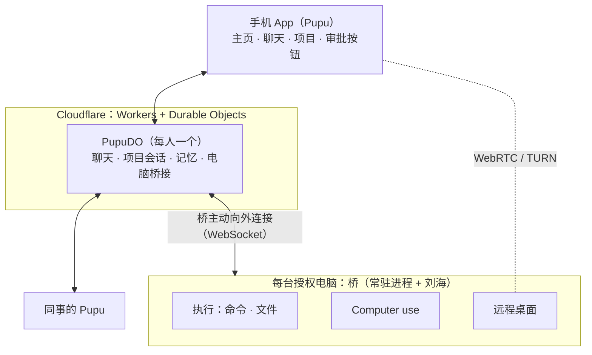

# Pupu 需求说明 v0.2

> 状态：需求澄清稿。v0.1 写于 2026-10-17，v0.2 修订于 2026-10-24。
>
> v0.2 的主要变化：
> - **不再接 Claude Code、Codex 等本地运行时。** Pupu 自己就是干活的 Agent，常驻云端，把授权的电脑当执行环境用：跑命令、读写文件、操作屏幕。做法参照 Grok Bot，拆解见 `docs/调研/grok-bot-本地执行拆解.md`。
> - **交互改为参考 Hark。** 主页、聊天、项目三屏；建项目用一句话确认；聊天把事转交给项目。
>
> 本文记录三类内容，各条都标了来源：
> - **已确认**：用户拍板的；
> - **默认**：建议的默认设计，用户没有反对，有异议可改；
> - **待定 / 待验证**：还要用户回答，或者要实测。

## 1. 一句话

Pupu 是一个常驻在云端的个人 Agent，手机就是 Pupu。你和它保持一条长期对话，它自己动手干活：在你授权的电脑上跑命令、读写文件、操作屏幕，把事情做完。电脑只是它的执行环境，人的交互入口只有 Pupu。

## 2. 要解决的问题

- 离开工位后，进行到一半的工作没法顺畅地接着做。电脑上的 agent 都要人守在旁边。
- 遥控本机 coding agent 的方案，本质是把终端搬到手机上，人还得自己一个个驱动会话。
- 我们要的是：只跟一个常驻的 Pupu 说话。它记得所有上下文，自己在电脑上把事做完；电脑掉线了，它也还在。

## 3. 核心场景

1. **离开工位接着推进**：在手机上对 Pupu 说"继续刚才那个"，Pupu 接着在工位电脑上跑命令、改代码，进展回到对话里。上下文都在云端，不依赖哪个终端开着。
2. **多台电脑配合**：Pupu 在一台电脑上改完代码，再到另一台上跑测试或部署。
3. **操作电脑完成闭环**：Pupu 在授权给它的电脑上把应用跑起来、看效果、点系统弹窗，完成命令行做不到的那部分。
4. **团队协作**：把项目共享给同事，同事的 Pupu 能看到进展，授权后还能推进。两个 Pupu 之间可以直接对话。

## 4. 产品形态

### 4.1 手机 App 就是 Pupu（已确认）

- 每个用户有一个 Pupu。它是云端的一个 Durable Object 实例，里面跑 pi-durable。手机关掉，它照样在运行。
- 交互参考 Hark（2026-10-23 确认），分三屏：
  - **主页**：Pupu 手上的事，按面板显示，比如项目、电脑；
  - **聊天**：一条长期对话，不区分新旧会话；
  - **项目**：直接打开上次的项目会话，左侧抽屉用来切换和新建。
- 长按消息可以复制、引用回复。
- 审批做成按钮（默认）：出现在对话和推送里，一键批准或拒绝。
- 主动汇报（默认）：进展按节奏推进对话里，不刷屏。

### 4.2 聊天（已确认）

- 一次性的小事直接办，比如查个东西、在电脑上跑一条命令。
- 属于已有项目的事：Pupu 转交给那个项目去做，结果发在项目里。聊天里的回复上方挂一个项目标签，点一下就过去。
- 需要持续推进、又没有合适项目的事：Pupu 用一句话问要不要建项目，用户答应了才建。
- 用户说就在聊天里做，就在聊天里做，不反复劝。

### 4.3 项目（已确认）

- 一个项目就是一个持续运行的项目会话。用户在项目里也是跟 Pupu 说话。
- 一个项目可以用到一两台电脑。
- 项目里能看到 Pupu 在电脑上干了什么（默认）：以可展开的卡片显示跑了什么命令、改了哪个文件、实时输出等，只能看。

### 4.4 电脑是 Pupu 的执行环境（已确认，2026-10-24）

- **不接本地运行时。** Agent 的回合只在云端跑，电脑只提供执行能力，和 Grok Bot 一样。人的交互入口只有 Pupu 本体。
- **任何授权给 Pupu 的电脑都可以用。** 一个 Pupu 可以同时用好几台，每个动作指定在哪台上做。
- **执行能力分两批：**
  - 第一批：跑命令，包括前台流式输出、放到后台运行并把输出写成文件、往运行中的命令写输入；读写文件、列目录、传文件；
  - 第二批：截图和操作屏幕，见 4.5。基本动作（截图、点击、移动、拖动、滚动、打字、按键）已经接到桥上。刘海请示、输入控制权交接和远程桌面还没做。
- **电脑掉线时，Pupu 照常对话，只是用不了这台电脑。** 它会如实告诉用户，等电脑回来再做。
- **桥：** 每台电脑上一个常驻进程，主动向外连云端，电脑上不开端口。每台电脑一个设备凭据，可以单独吊销。

### 4.5 操作屏幕（已确认）

现状和下面几条还没对齐：截图和键鼠已经能用，点之前不会先问，也没有刘海。下面仍然是要补上的行为。

- 用日常电脑时：人离开时不锁屏，由 Pupu 接管屏幕。刘海上一直显示"Pupu 正在操作"，一键就能收回控制权。
- 人正在用这台电脑时（默认）：Pupu 只跑命令；如果要动屏幕，先在刘海上请示。
- 刘海的定位：它是 Pupu 在这台电脑上的"在场标识"，显示：
  - Pupu 是否在用这台电脑、在跑什么；
  - Pupu 是否正在操作屏幕；
  - 一键收回的入口。
- 已经落地的截图和键鼠，按 Grok Bot 的方式做：先截图，再用图上的像素坐标点、拖、滚动和打字。后面的输入控制权交接仍参考 Cindy：把 cua-driver 包装成工具，并协调"现在是人还是 Pupu 在控制输入"。
- 远程桌面也参考 Cindy：
  - 视频走 WebRTC，输入走有序的 DataChannel；
  - 使用短期有效的 TURN 凭证；
  - 连不通时，通过中继发 JPEG 兜底；
  - 同一时间只有一个人控制，其他人可以接管。
- 视频流不经过 Durable Object。

### 4.6 自主权限（已确认：分级）

| 自动执行 | 弹按钮确认 |
|---|---|
| 在已有项目里推进任务 | 动用另一台电脑 |
| 低风险动作，比如读文件、列目录、跑测试 | 高风险命令，比如删除、push、发布 |
| | 高风险的界面操作，比如发消息、付款（默认） |

云端和电脑各判一次（默认，参照 Grok Bot）：
- 云端按分级决定要不要问人；
- 电脑上按本机的开关再判一次，本机可以拒绝云端已经批准的动作。

### 4.7 协作（已确认）

- 每人一个 Pupu，协作靠共享项目。
- 共享项目默认只读，驾驶权由项目所有者按项目授予。
- Pupu 之间可以聊天，不限于共享项目。比如可以问"Alice 今天在忙什么"，对方的 Pupu 按主人的**透露设置**决定说多少。透露设置默认保守：只说项目名和进度，不说对话内容。
- 别人的 Pupu 请求动用你的电脑时（默认），按你的权限分级处理，超出范围要你确认。

**Pupu 之间的通信设计**（默认，参考 Reason Network，见第 10 节）：

1. **按"人/对象"寻址。** Pupu 之间、项目之间的消息都用统一的地址格式：
   - `alice/pupu`：Alice 的 Pupu；
   - `alice/登录改版`：Alice 的一个项目。
2. **在场状态从项目里提取。** 包括谁在做什么、忙还是闲、在哪个仓库哪个分支，从各项目的状态和 Pupu 最近在电脑上做的事里取。别人问"Alice 今天在忙什么"时，按这份状态回答，回答前先经过透露设置过滤。
3. **靠可见性避免冲突，不加锁。** Pupu 在一个仓库或分支上动手之前，先查有没有别人的 Pupu 在动：
   - 有，就去问那个 Pupu，不重复动手；
   - 冲突无法避免时，提醒双方的主人。
4. **消息按线程组织。** Pupu 之间的消息是一段段对话，不是一条条孤立的消息：
   - 支持"问了就等答复"，后续追问接在同一线程里；
   - 双方主人都能看到线程记录。

Reason Network 本身不直接采用，原因有三：
- 它是点对点网络，而 Pupu 在云端，DO 之间直接调用即可；
- 它连接的是各自电脑上的 agent，而 Pupu 的 Agent 在云端；
- 它没有透露设置和权限分级。

### 4.8 部署（默认）

- 先给自己和团队用，部署在自己的 Cloudflare 账号上。
- 信任云端：云端 Agent 可以读明文，不做端到端加密。
- 团队在海外办公（已确认），不需要考虑大陆网络的限制。

## 5. 架构

- **PupuDO**：用 pi-durable（PiHarness）跑对话。聊天是根会话，每个项目各是一个会话，共用这个 DO 的 SQLite。另外还管长期记忆、项目索引，以及 Pupu 之间的消息收发。项目多了、或者要共享项目时，再把项目拆成单独的 ProjectDO（默认）。
- **电脑桥接**：在 PupuDO 里，参照 Grok Bot 云端的 `SandLocalExecBridge`。
  - 每台电脑一条可休眠的 WebSocket；
  - 桥连上后先报电脑 id 和名字，之后靠心跳判断在线；
  - 每个请求带 requestId，结果流式返回，可以取消，有回包超时。
- **桥**：常驻进程是本体。刘海是它的界面，相当于 Grok Bot 里管 daemon 的 supervisor。桥手上还有命令在跑时，刘海退出或升级不会带走它。
- **长命令的输出写成文件。** Pupu 用读文件去追，长任务不用占着连接，断线重连后也不丢输出。
- **工具的位置**：Pupu 的工具定义在云端，执行时经桥已有的出站连接发到电脑上。不用 MCP client 直连电脑，因为 Cloudflare Agents SDK 的 MCP client 会拦截内网 IP，而且电脑不开端口。
- **长期对话的记忆分层**：完整记录存在 SQLite 里，每一轮只带三样东西：最近的对话、各活跃项目的摘要、检索到的相关内容。
- **推送**：部署后的 Worker 直接 fetch APNs，用 ES256 JWT 签名。这是社区实测可用的行为，不是官方保证；本地 `wrangler dev` 下无效。

## 6. 和已有产品的区别

- **遥控本机 coding agent**：Claude Code Remote Control、Codex Remote、Happy、HAPI、Paseo、Cindy。人还是在驱动电脑上的 agent，手机只是遥控器。
- **刘海状态类**：Vibe Notch、CodeIsland、Coucou、Vibe Island，都是基于 hooks 实现的。
- **最接近的是 Grok Bot**：Agent 在云端，电脑是执行环境。

Pupu 的差异在于：

1. 手机优先，交互是一条长期对话加项目（参考 Hark），而不是一堆会话；
2. 跑在自己的 Cloudflare 账号上，模型自己选；
3. 每人一个 Pupu，可以共享项目，Pupu 之间也能对话。

远程桌面能复用就复用：Cindy 是 Apache-2.0 或 MIT 协议。

## 7. 风险与约束

- **合规**：云端 Agent 调用 Claude 要用 API key，按量付费，不能借用户的 Claude 订阅。
- **依赖实验性接口**：pi-durable（experimental）、PiHarness（beta）。要锁定版本。
- **PiHarness 目前的缺口**：
  - 没有工具审批环节，要自己用 `beforeTool` 拦截；
  - 客户端重连只能拿到快照，不能按游标接着读；
  - 超过 15 分钟的模型流可能被切断。

  另外要注意：跑命令、写文件这类工具不能标成 `replay:"safe"`，桥那边也要按 requestId 去重。
- **在日常电脑上直接跑命令**：Pupu 的命令直接跑在用户的电脑上，没有沙箱，靠权限分级和本机二次判断兜底。要不要提供隔离环境，比如 Grok Bot 的本地 Docker box，待定。
- **不锁屏的安全风险**：日常电脑离开时不锁屏，存在安全风险。锁屏后，基于截图和点击的操作基本做不了（待实测）。
- **电脑必须醒着**：要防止睡眠。电脑离线时，Pupu 要如实说明，等它回来再做。
- **成本**：computer use 的截图很费 token；长期对话和多个项目会话同时在跑，模型费用也要提前估算。

## 8. 建议的落地顺序

**已完成**：云端 Pupu 网页版，包括聊天、项目、转交、引用回复，2026-10-23 部署。

0. **电脑桥接**：在手机上对 Pupu 说一件要在电脑上做的事，Pupu 通过桥在电脑上跑命令、读写文件、按截图坐标操作屏幕，把结果带回对话；电脑掉线时如实说明。基本动作已落地。刘海请示还没做，所以现在点屏幕之前不会先问。
   - 云端：PupuDO 里的电脑桥接；工具有列电脑、跑命令、读写文件、截图和键鼠。
   - 桥：命令行常驻进程，用 launchd 拉起，主动连云端。屏幕操作由本机的 `pupu-computer-use` 完成，需要屏幕录制和辅助功能权限。
   - 手机端：继续用网页。主页「电脑」面板显示在线状态。右上角「我」打开设置，可以看状态和吊销。
1. **MVP（自用）**：
   - 多台电脑；
   - 权限分级和审批按钮；
   - 推送；
   - 刘海：显示状态、做审批、一键收回。补上 4.5 里「点屏幕之前先请示」。
2. **Computer use 的后半**：
   - 人和 Pupu 之间的输入控制权协调；
   - 远程桌面。
3. **协作**：共享项目、驾驶权、审计日志；Pupu 之间聊天，支持透露设置。

第 2、3 步的先后可以调换。这里建议先把一个人的闭环做完整，再做协作。

## 9. 待定与待验证

**待定（需要用户回答）**

- 授权电脑是否也包括云端机器。Grok Bot 就是每个 bot 配一台持续存在的云电脑。
- 在日常电脑上直接跑命令，还是给 Pupu 一个隔离环境（Docker、虚拟机）。
- 手机端先做 iOS 还是双端，用原生开发还是跨平台。
- Pupu 用哪家模型，预算多少。
- 透露设置的默认值、项目归档规则。

**待验证（需要实测）**

- 锁屏之后，GUI 操作是否还可行；虚拟机是否不受宿主锁屏的影响。
- 桥长时间挂着可休眠的 WebSocket，稳定性和费用如何。
- 在 Workers 里发 APNs 是否稳定。

## 10. 参考

**本地执行**

- Grok Bot 拆解：`docs/调研/grok-bot-本地执行拆解.md`
- Grok Bot 报道：[Interesting Engineering](https://interestingengineering.com/ai-robotics/xai-grok-bot-computer-agent)、[MindStudio](https://www.mindstudio.ai/blog/grok-bot-ai-agent-fleet/)

**云端**

- [pi-durable 发布文章](https://earendil.com/posts/pi-durable/)
- [pi-durable README](https://github.com/earendil-works/pi/blob/main/packages/durable/README.md)
- [PiHarness](https://developers.cloudflare.com/agents/harnesses/pi/)
- [DO 限制](https://developers.cloudflare.com/durable-objects/platform/limits/)
- [DO WebSocket](https://developers.cloudflare.com/durable-objects/best-practices/websockets/)
- [Agents 持久执行](https://developers.cloudflare.com/agents/api-reference/durable-execution/)
- [Agents MCP client](https://developers.cloudflare.com/agents/model-context-protocol/apis/client-api/)
- [Cloudflare Realtime](https://developers.cloudflare.com/realtime/)
- [在 Workers 里发 APNs 的讨论](https://github.com/cloudflare/workerd/issues/4841)

**同类产品**

- [Happy](https://github.com/slopus/happy)
- [HAPI](https://github.com/tiann/hapi)
- [Paseo](https://github.com/getpaseo/paseo)
- Cindy：
  - [device-link](https://github.com/makecindy/cindy/blob/main/packages/device-link/README.md)
  - [远程桌面](https://github.com/makecindy/cindy/blob/main/docs/remote-desktop.md)
- [CodeIsland](https://github.com/wxtsky/CodeIsland)
- [Coucou](https://github.com/Louis-CFM/coucou)
- [Vibe Notch](https://github.com/farouqaldori/vibe-notch)
- Reason Network：[介绍页](https://reasonmachines.com/network)、[GitHub](https://github.com/reason-machines/reason-network)、[发布推文](https://x.com/reasonmachines/status/2111135100142518430)

**交互参考**

- Hark：
  - [官方介绍](https://hark.com/articles/introducing-hark-pro)
  - [上手评测](https://aiprofitboardroom.com/blog/hark-ai-agent/)

## 附：术语

| 术语 | 含义 |
|---|---|
| Pupu | 每个用户在云端的个人 Agent。一个 DO 实例，里面跑 pi-durable |
| 聊天 | 跟 Pupu 的一条长期对话，也叫主对话 |
| 项目 / 项目会话 | 一个持续运行、由 Pupu 代办的项目级对话 |
| 授权电脑 | 允许 Pupu 使用的电脑，是 Pupu 的执行环境 |
| 桥 | 每台授权电脑上的常驻进程，连接云端，替 Pupu 在本机执行。刘海是它的一个界面 |
| 驾驶权 | 能向项目发指令、做审批的权限 |
| 透露设置 | 你的 Pupu 可以向别人的 Pupu 透露哪些信息 |
